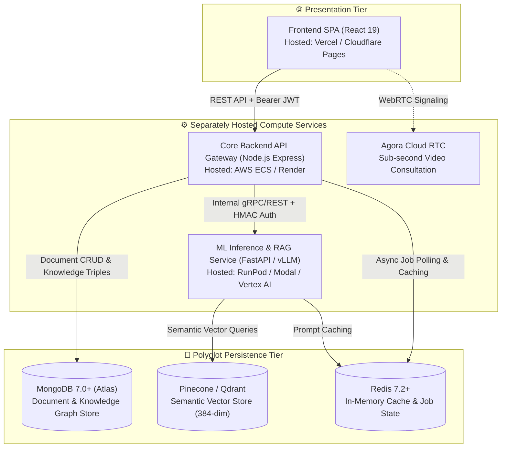

# AyurVarta — AI-Powered Personalized Ayurvedic Wellness Platform

Submitted for **Smart India Hackathon (SIH 2025)**.

AyurVarta is a distributed, polyglot-persistent digital health platform combining ancient Ayurvedic principles with modern clinical Artificial Intelligence. It evaluates an individual's **Prakriti** (innate constitutional baseline), **Vikriti** (current dosha imbalance), and **Agni** (digestive metabolic state) to retrieve suitable healing foods and synthesize structured, safe, and personalized diet charts.

---

## 🏛️ Distributed & Polyglot System Architecture

The platform is decomposed into discrete, separately hosted microservices and polyglot databases following the project's [Project Rules](PROJECT_RULES.md) (aligned with [Vibe Rules](Vibe_Rules.md)):



---

## 📚 Service & Architecture Documentation

All architectural and service specifications are organized under [`docs/`](docs):

| Documentation Guide | Target Focus | Key Technologies |
| :--- | :--- | :--- |
| **[Distributed Architecture Overview](docs/architecture/OVERVIEW.md)** | End-to-end distributed system & data flow | Microservices, Polyglot Persistence, Sequence Flow |
| **[Frontend Client Service](docs/services/frontend-service.md)** | UI, Quizzes, Diet UI, Video Consult, PDF export | React 19, Tailwind CSS, Chart.js, Agora RTC |
| **[Core Backend Service](docs/services/core-backend-service.md)** | API Gateway, Auth/RBAC, Job Broker, Orchestrator | Node.js 20+, Express.js, MongoDB Driver, Redis |
| **[ML Inference & RAG Service](docs/services/ml-inference-service.md)** | Embeddings, Vector Retrieval, LLM & Guardrails | Gemini 2.5 Pro, Groq, Pinecone, Charaka 18 Rules |
| **[MongoDB Document Store](docs/services/database-mongodb.md)** | User profiles, assessments, logs, KG triples | MongoDB Atlas 7.0+, Compound Indexes |
| **[Vector Database Service](docs/services/database-vectordb.md)** | High-dim food embeddings & metadata filters | Pinecone Serverless / Qdrant, Cosine Similarity |
| **[Redis Cache & Job Broker](docs/services/database-redis.md)** | Async job polling, cohort cache, rate limiting | Redis 7.2+, Leaky Bucket, TTL keys |
| **[Project Rules & Conventions](PROJECT_RULES.md)** | Standards, API contracts, error schemas, DoD | Based on `Vibe_Rules.md` |
| **[Implementation Checklist](docs/CHECKLIST.md)** | Multi-phase delivery checklist & tracking | Progress Dashboard, Phase milestones |
| **[Clinical RAG Gap Analysis](docs/architecture/gap-analysis.md)** | Technical comparison against clinical RAG | Ingestion, Reranking, CRAG guardrails |
| **[Full Implementation Plan](docs/architecture/implementation-plan.md)** | 4-phase technical roadmap & sprint plan | Ingestion, Retrieval, Safety, Observability |

---

## 🛠️ Repository Directory Structure

```
Ayurvarta/
├── frontend/                  # React 19 Client SPA
│   ├── src/                   # Pages, components, api clients, contexts
│   ├── public/                # Static assets & public data catalogs
│   ├── Dockerfile             # Multi-stage production container
│   ├── nginx.conf             # Production SPA routing config
│   └── package.json           # React 19 & dependencies
├── backend/                   # Core Backend & API Gateway Service (Node.js)
│   ├── src/                   # Server, middleware, config & routes
│   │   ├── server.js          # Express app, correlation IDs, health checks
│   │   └── config/index.js    # Environment configuration
│   ├── Dockerfile             # Container definition (node:20-alpine)
│   ├── package.json           # Express, MongoDB, ioredis, JWT
│   └── .env.example           # Environment template
├── ml-service/                # Dedicated ML & Clinical RAG Service
│   ├── app.py                 # FastAPI inference endpoints, HMAC security
│   ├── config.py              # Pydantic BaseSettings (Gemini, Pinecone, Groq)
│   ├── Dockerfile             # Container definition
│   └── requirements.txt       # GenAI SDK, Pinecone, Groq
├── docs/                      # Centralized documentation
│   ├── architecture/          # Overview, gap analysis, implementation plan
│   └── services/              # Individual service documentation
├── docker-compose.yml         # One-command orchestration for entire stack
├── PROJECT_RULES.md           # Persistent development rules & standards
└── Vibe_Rules.md              # Master microservices checklist
```

---

## 🚀 One-Command Local Development Setup

Run the entire polyglot distributed stack locally using Docker Compose:

```bash
docker-compose up --build
```

Or run services individually:

### 1. Frontend Client
```bash
cd frontend
npm install
npm test -- --watchAll=false
npm start # Accessible on http://localhost:3000
```

### 2. Core Backend Service
```bash
cd backend
npm install
npm run dev # Accessible on http://localhost:8000
```

### 3. Dedicated ML Inference Service
```bash
cd ml-service
python -m venv venv
# Windows: .\venv\Scripts\activate | Unix: source venv/bin/activate
pip install -r requirements.txt
uvicorn app:app --reload --port 8001 # Accessible on http://localhost:8001
```
