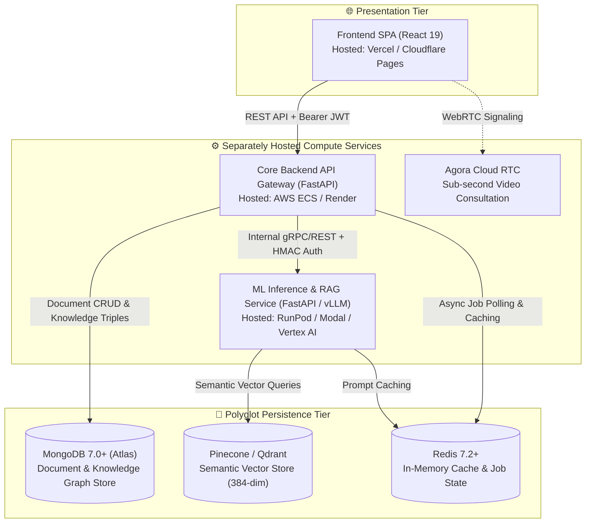

# AyurVarta — AI-Powered Personalized Ayurvedic Wellness Platform

Submitted for **Smart India Hackathon (SIH 2025)**.

AyurVarta is a distributed, polyglot-persistent digital health platform combining ancient Ayurvedic principles with modern clinical Artificial Intelligence. It evaluates an individual's **Prakriti** (innate constitutional baseline), **Vikriti** (current dosha imbalance), and **Agni** (digestive metabolic state) to retrieve suitable healing foods and synthesize structured, safe, and personalized diet charts.

---

## 🏛️ Distributed & Polyglot System Architecture

The platform is decomposed into discrete, separately hosted microservices and polyglot databases following the project's [Project Rules](PROJECT_RULES.md) (aligned with [Vibe Rules](Vibe_Rules.md)):



---

## 📚 Service & Architecture Documentation

Detailed architectural and service specifications are documented below:

| Documentation Guide | Target Focus | Key Technologies |
| :--- | :--- | :--- |
| **[Distributed Architecture Overview](docs/architecture/OVERVIEW.md)** | End-to-end distributed system & data flow | Microservices, Polyglot Persistence, Sequence Flow |
| **[Frontend Client Service](docs/services/frontend-service.md)** | UI, Quizzes, Diet UI, Video Consult, PDF export | React 19, Tailwind CSS, Chart.js, Agora RTC |
| **[Core Backend Service](docs/services/core-backend-service.md)** | API Gateway, Auth/RBAC, Ontology, Job Broker | Python 3.11+, FastAPI, Pydantic v2, Motor |
| **[ML Inference & RAG Service](docs/services/ml-inference-service.md)** | Embeddings, Vector Retrieval, LLM & Guardrails | Gemini 2.5 Pro, Groq, Pinecone, Charaka 18 Rules |
| **[MongoDB Document Store](docs/services/database-mongodb.md)** | User profiles, assessments, logs, KG triples | MongoDB Atlas 7.0+, Compound Indexes |
| **[Vector Database Service](docs/services/database-vectordb.md)** | High-dim food embeddings & metadata filters | Pinecone Serverless / Qdrant, Cosine Similarity |
| **[Redis Cache & Job Broker](docs/services/database-redis.md)** | Async job polling, cohort cache, rate limiting | Redis 7.2+, Leaky Bucket, TTL keys |
| **[Project Rules & Conventions](PROJECT_RULES.md)** | Standards, API contracts, error schemas, DoD | Based on `Vibe_Rules.md` |

---

## ✨ Core Platform Features

- **Constitutional Assessments**: Multi-step interactive questionnaires assessing Prakriti, Vikriti, and Agni with visual charts and score breakdowns.
- **RAG-Driven Diet Generator**: Queries curated Ayurvedic food vectors from Pinecone using semantic embeddings expanded with classical pacifying tastes (*Shad-Rasa*) and qualities (*Vimshati Guna*).
- **Viruddha Ahara Safety Checking**: Integrated clinical guardrail checking meal plans against Charaka's 18 incompatibility rules to prevent adverse food pairings (e.g. heated honey, milk + fish, night curd).
- **Real-Time Tele-Consultations**: Video appointments connecting patients directly with certified Ayurvedic dietitians powered by the Agora RTC SDK.
- **Adherence & Habit Tracking**: Daily meal logging with adherence ratings (1-5 scale) and notes stored in MongoDB.
- **Personalized AI Assistant**: Interactive conversational guide answering Ayurvedic lifestyle and dinacharya questions.
- **Export & Reporting**: One-click PDF generation of complete diet charts using `html2canvas` and `jsPDF`.

---

## 🚀 One-Command Local Development Setup

Run the entire polyglot distributed stack locally using Docker Compose:

```bash
docker-compose up --build
```

Or run services individually:

### 1. Frontend Client
```bash
cd frontend
npm install
npm test -- --watchAll=false
npm start # Accessible on http://localhost:3000
```

### 2. Core Backend Service
```bash
cd backend
pip install -r requirements.txt
python -m ontology.verify
uvicorn main:app --reload --port 8000 # Accessible on http://localhost:8000
```

### 3. Dedicated ML Inference Service
```bash
cd ml-service
pip install -r requirements.txt
uvicorn app:app --reload --port 8001 # Accessible on http://localhost:8001
```

---

## 📖 Additional Tracking & Analysis

- [Implementation Checklist](CHECKLIST.md)
- [Gap Analysis vs Reference Clinical RAG](mds/gap-analysis.md)
- [Multi-Phase Implementation Roadmap](mds/implementation-plan01.md)
- [Vibe Coding Rules](Vibe_Rules.md)
