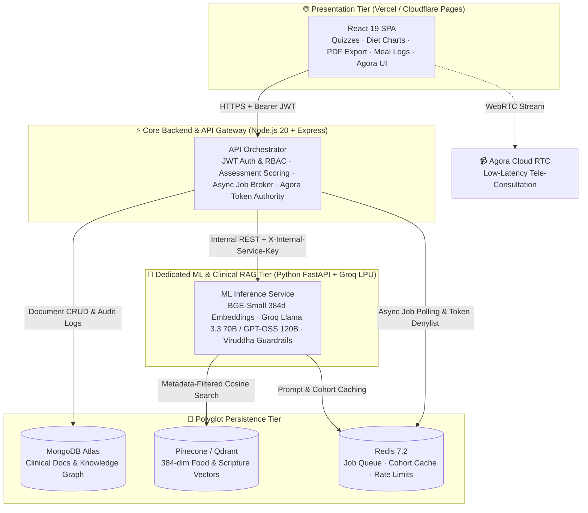
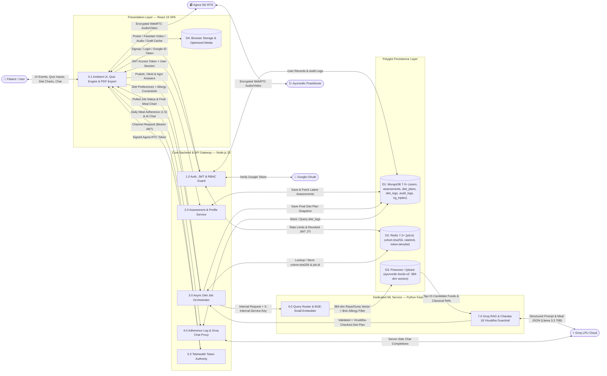
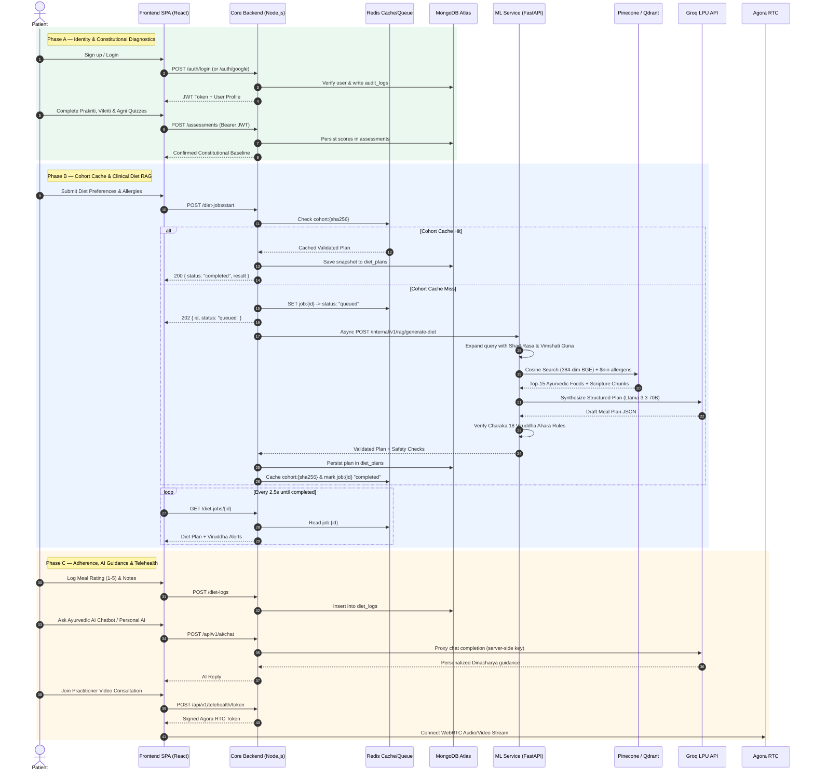

<div align="center">



<br />

<h3><strong>Where 5,000-Year-Old Ayurvedic Science Meets Ultra-Fast Groq AI &amp; Polyglot Microservices</strong></h3>

[](frontend)
[](backend)
[](ml-service)
[](docs/services/ml-inference-service.md)
[](docs/services/database-mongodb.md)
[](docs/services/database-vectordb.md)
[](docs/services/database-redis.md)
[](docker-compose.yml)

[Architecture](#-distributed-polyglot-architecture) · [Data Flow (DFD)](#-complete-end-to-end-data-flow-dfd) · [Why Polyglot?](#-why-polyglot-persistence) · [Backend Plan](docs/architecture/backend-plan.md) · [Documentation](#-service-documentation-hub) · [Quick Start](#-quick-start)

</div>

---

## ✨ Why AyurVarta?

Modern nutrition apps reduce human health to generic calorie math—ignoring digestive capacity, seasonal transitions, and dangerous ingredient pairings.

**AyurVarta** reimagines personalized digital healthcare by uniting classical **Ayurvedic diagnostics** with a **distributed, clinically guarded AI pipeline**:

| Standard Diet Apps | 🌿 AyurVarta Clinical Platform |
| :--- | :--- |
| One-size-fits-all calorie macros | Evaluates **Prakriti** (constitution), **Vikriti** (imbalance), and **Agni** (digestive fire) |
| Static recipe lists | Semantic retrieval grounded in **Shad-Rasa** (6 tastes) & **Vimshati Guna** (20 qualities) |
| No food-pairing safety checks | Screens every meal against **Charaka's 18 *Viruddha Ahara*** incompatibility rules |
| Slow, monolithic servers | Decoupled **React + Node.js + Python/Groq ML** services with **3-tier Polyglot Persistence** |

---

## 🏛️ Distributed Polyglot Architecture

Every component in AyurVarta is independently hosted, loosely coupled, and governed by strict service boundaries—with **zero shared databases** and end-to-end `X-Request-Id` tracing.



---

## 💾 Why Polyglot Persistence?

Ayurvedic clinical data spans hierarchical questionnaires, dense vector embeddings, and real-time job queues. Instead of forcing one database to do everything poorly, AyurVarta assigns each engine to what it does best:

| Storage Engine | Data Paradigm | What It Owns | Why It Excels Here |
| :--- | :--- | :--- | :--- |
| **MongoDB 7.0+** | Document Store & KG Triples | `users`, `assessments`, `diet_plans`, `diet_logs`, `audit_logs`, `kg_entities`, `kg_relations` | Evolves smoothly alongside dynamic quiz schemas and deeply nested meal plans without rigid migrations. |
| **Pinecone / Qdrant** | High-Dimensional Vector DB | `ayurvedic-foods-v2` (`foods` & `scriptures` namespaces, 384-dim `BAAI/bge-small-en-v1.5`) | Sub-second semantic matching on tastes/qualities with hard `$nin` allergen filtering *before* LLM synthesis. |
| **Redis 7.2+** | In-Memory Store & Broker | `job:{id}`, `cohort:{sha256}`, `ratelimit:{scope}:{id}`, `token:denylist:{jti}` | Enables instant frontend polling, caches identical Dosha/Agni/Season cohorts, and enforces rate limits in RAM. |

---

## 🔀 Complete End-to-End Data Flow (DFD)

### 1. Platform Data Flow Diagram (Level 1 — All Services & Polyglot Stores)

The diagram below traces every data movement across external actors, microservices, AI inference, real-time telehealth, and polyglot persistence stores:



---

### 2. Full Lifecycle Sequence Flow (Auth ➔ Diagnostics ➔ Diet RAG ➔ Adherence ➔ Telehealth)



---

### 3. Data Flow Inventory Matrix

| Flow | Source ➔ Destination | Payload & Schema | Backing Store | Transport & Security |
| :--- | :--- | :--- | :--- | :--- |
| **Auth & Session** | Frontend ➔ Backend ➔ MongoDB/Redis | Credentials / Google ID Token ➔ JWT + Refresh Token | `users`, `refresh_tokens`, `audit_logs`, `token:denylist` | HTTPS, bcrypt (12), JWT + `X-Request-Id` |
| **Assessments** | Frontend ➔ Backend ➔ MongoDB | `{ type, scores, schema, disease, capturedAt }` | `assessments` (`userId` + `type` compound index) | HTTPS + Bearer JWT, IDOR ownership check |
| **Diet Plan RAG** | Frontend ➔ Backend ➔ ML ➔ VectorDB/Groq | Prakriti/Vikriti/Agni + Allergies + Season ➔ Meal Chart | `job:{id}`, `cohort:{sha256}`, `ayurvedic-foods-v2`, `diet_plans` | Internal REST + `X-Internal-Service-Key` |
| **Meal Adherence** | Frontend ➔ Backend ➔ MongoDB | `{ mealType, mealName, notes, adherence: 1..5 }` | `diet_logs` | HTTPS + Bearer JWT |
| **Groq AI Assistant** | Frontend ➔ Backend ➔ Groq Cloud | Chat history + Dosha context ➔ Markdown guidance | Ephemeral / Stateless | HTTPS + Bearer JWT (server-side `GROQ_API_KEY`) |
| **Tele-Consultation** | Frontend ➔ Backend ➔ Agora SD-RTN | Channel name ➔ Signed RTC Token ➔ WebRTC media stream | Ephemeral RTC Session | Server-signed Agora App Certificate + DTLS-SRTP |
| **Ambient Hero Media** | Public Assets / CDN ➔ Browser | `bgPoster.webp` (`385 KB`), faststart `bgVideo.mp4` (`77.4 MB`), `BgMusic.mp3` | Browser Disk Cache + Nginx `immutable` | HTTP Byte-Range (`Accept-Ranges: bytes`) |

---

## 🧩 Core Platform Capabilities

- **🧬 Tri-Pillar Diagnostic Engine**: Interactive multi-step Prakriti, Vikriti, and Agni assessments with live Chart.js visualizations and historical trend tracking.
- **⚡ Groq-Powered Clinical RAG**: Sub-second inference powered by Groq (`llama-3.3-70b-versatile` & `openai/gpt-oss-120b`) paired with 384-dim semantic vector search.
- **🛡️ *Viruddha Ahara* Clinical Safety**: Automated post-generation rules engine catching toxic food combinations, preparation hazards, and seasonal mismatches.
- **📹 Real-Time Tele-Consultation**: Secure patient-practitioner video appointments powered by Agora RTC SDK with server-signed channel tokens.
- **📊 Adherence & Habit Analytics**: Daily meal compliance tracking (1–5 rating + digestive notes) persisted in MongoDB.
- **📄 One-Click Clinical PDF Export**: Crisp client-side generation of full diet charts, guidelines, and spice recommendations.

---

## 📚 Service & Architecture Documentation Hub

Explore dedicated specifications, schemas, contracts, and engineering plans:

| Document | Focus | Stack / Scope |
| :--- | :--- | :--- |
| **[Architecture Overview](docs/architecture/OVERVIEW.md)** | System topology, boundaries & end-to-end sequence flows | Distributed Microservices |
| **[Node.js Backend Plan](docs/architecture/backend-plan.md)** | **6-phase implementation blueprint & exact frontend contracts** | Node.js 20, Express, MongoDB, Redis |
| **[Frontend Service](docs/services/frontend-service.md)** | SPA pages, assessments, Agora video, Groq client & PDF export | React 19, Router v7, Chart.js |
| **[Core Backend Service](docs/services/core-backend-service.md)** | API Gateway, JWT/RBAC, job orchestration & telehealth tokens | Node.js 20, Express ES Modules |
| **[ML Inference & RAG Service](docs/services/ml-inference-service.md)** | Embeddings, vector search, Groq synthesis & Viruddha guardrails | Python 3.11+, FastAPI, Groq, FastEmbed |
| **[MongoDB Document Store](docs/services/database-mongodb.md)** | BSON schemas, Knowledge Graph triples & compound indexes | MongoDB 7.0+ (Atlas) |
| **[Vector Database Service](docs/services/database-vectordb.md)** | `ayurvedic-foods-v2` namespaces, metadata filters & cosine metrics | Pinecone Serverless / Qdrant |
| **[Redis Cache & Broker](docs/services/database-redis.md)** | Job state machine, cohort hashing, rate limits & token denylist | Redis 7.2+ |
| **[Project Rules](PROJECT_RULES.md) & [Vibe Rules](Vibe_Rules.md)** | Error envelopes, correlation IDs, security & DoD checklists | Engineering Standards |

---

## 📂 Repository Map

```text
Ayurvarta/
├── frontend/                  # 🌐 React 19 Client SPA (Docker + Nginx ready)
│   ├── public/                #    Faststart video, poster, audio, Migano font & catalogs
│   ├── src/api/               #    REST clients (auth, assessments, diet jobs, Groq AI)
│   ├── src/components/        #    FoggyGlassOverlay, LiquidGlassTitle, Chatbot, Modals
│   ├── src/pages/             #    Home, Assessments, Dashboard, DietPlan, VideoConsult
│   └── Dockerfile             #    Multi-stage Node 20 -> Nginx Alpine build
├── backend/                   # ⚡ Node.js 20 Core Backend & API Gateway
│   ├── src/server.js          #    Express entry, X-Request-Id, /health & /ready probes
│   ├── src/config/index.js    #    Centralized env configuration
│   └── Dockerfile             #    Production node:20-alpine container
├── ml-service/                # 🧠 Python FastAPI ML & Groq RAG Service
│   ├── app.py                 #    Internal RAG endpoint (/internal/v1/rag/generate-diet)
│   ├── config.py              #    Groq, Pinecone & BGE-Small settings
│   └── Dockerfile             #    Python 3.11-slim container
├── docs/                      # 📚 Centralized architecture, assets, service docs & plans
│   ├── assets/                #    Animated SVG hero banner (ayurvarta-hero.svg)
│   ├── architecture/          #    Overview, backend-plan, gap-analysis, implementation-plan
│   └── services/              #    Individual service & polyglot database specs
├── docker-compose.yml         # 🐳 Full polyglot stack (MongoDB, Redis, Qdrant, 3 services)
├── PROJECT_RULES.md           # 📜 Persistent rules & API contracts
└── Vibe_Rules.md              # ✅ Microservice engineering master checklist
```

---

## 🚀 Quick Start

### Option A: One-Command Full Stack (Docker Compose)

Spin up **MongoDB, Redis, Qdrant Vector DB, ML Service, Node.js Backend, and React Frontend** together:

```bash
# Set your Groq API key (optional in dev mode; stubbed fallback works out of the box)
export GROQ_API_KEY="gsk_your_key_here"

docker-compose up --build
```

| Service | Local URL | Health Probe |
| :--- | :--- | :--- |
| **Frontend SPA** | `http://localhost:3000` | `http://localhost:3000/` |
| **Core Backend (Node.js)** | `http://localhost:8000` | `http://localhost:8000/health` |
| **ML Inference Service (Groq)** | `http://localhost:8001` | `http://localhost:8001/health` |
| **Qdrant Vector Dashboard** | `http://localhost:6333/dashboard` | — |

---

<details>
<summary><b>🛠️ Option B: Run Individual Services Locally (Click to Expand)</b></summary>

#### 1. Core Backend Service (`Node.js 20+`)
```bash
cd backend
cp .env.example .env
npm install
npm run dev          # Hot-reloads on http://localhost:8000
```

#### 2. ML Inference Service (`Python 3.11+`)
```bash
cd ml-service
cp .env.example .env
python -m venv venv
# Windows: .\venv\Scripts\activate  |  macOS/Linux: source venv/bin/activate
pip install -r requirements.txt
uvicorn app:app --reload --port 8001
```

#### 3. Frontend SPA (`React 19`)
```bash
cd frontend
cp .env.example .env
npm install
npm test -- --watchAll=false
npm start            # Opens http://localhost:3000
```

</details>

<details>
<summary><b>🗺️ Additional Roadmaps & Audits (Click to Expand)</b></summary>

- [**Implementation Checklist**](docs/CHECKLIST.md) — Track sprint progress across ontology, RAG, and guardrails.
- [**Clinical RAG Gap Analysis**](docs/architecture/gap-analysis.md) — Baseline comparison against clinical RAG benchmarks.
- [**Full Multi-Phase RAG Plan**](docs/architecture/implementation-plan.md) — Deep-dive ingestion, hybrid retrieval, and CRAG roadmap.

</details>

---

<div align="center">

Built with classical precision and modern distributed engineering · **Team AyurVarta**

</div>
