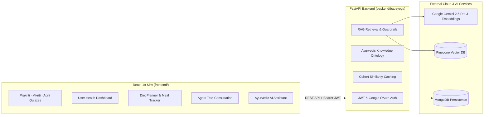

# AyurVarta — AI-Powered Personalized Ayurvedic Wellness Platform

Submitted for **Smart India Hackathon (SIH 2025)**.

AyurVarta is an integrated digital health platform combining ancient Ayurvedic principles with modern clinical Artificial Intelligence. It evaluates an individual's **Prakriti** (innate constitutional baseline), **Vikriti** (current dosha imbalance), and **Agni** (digestive metabolic state) to retrieve suitable healing foods and synthesize structured, safe, and personalized diet charts.

---

## 🏛️ System Architecture



---

## ✨ Core Platform Features

- **Constitutional Assessments**: Multi-step interactive questionnaires assessing Prakriti, Vikriti, and Agni with visual charts and score breakdowns.
- **RAG-Driven Diet Generator**: Queries curated Ayurvedic food vectors from Pinecone using semantic embeddings expanded with classical pacifying tastes (Shad-Rasa) and qualities (Vimshati Guna).
- **Viruddha Ahara Safety Checking**: Integrated guardrail checking meal plans against Charaka's 18 incompatibility rules to prevent adverse food pairings (e.g. heated honey, milk + fish).
- **Real-Time Tele-Consultations**: Video appointments connecting patients directly with certified Ayurvedic dietitians powered by the Agora RTC SDK.
- **Adherence & Habit Tracking**: Daily meal logging with adherence ratings (1-5 scale) and notes stored in MongoDB.
- **Personalized AI Assistant**: Interactive conversational guide answering Ayurvedic lifestyle and dinacharya questions.
- **Export & Reporting**: One-click PDF generation of complete diet charts using `html2canvas` and `jsPDF`.

---

## 🛠️ Tech Stack

### Frontend ([`frontend/`](frontend))
- **Core**: React 19, React Router v7
- **Styling**: Tailwind CSS, CSS Modules, Lucide React icons
- **Visualizations**: Chart.js, `react-chartjs-2`
- **Telemedicine**: `agora-rtc-sdk-ng`
- **PDF Generation**: `html2canvas`, `jspdf`

### Backend ([`../backend/babayogi`](../backend/babayogi))
- **Framework**: Python 3.11+, FastAPI, Uvicorn, Pydantic v2
- **Vector Search**: Pinecone (`ayurvedic-foods-v2`)
- **LLM & Embeddings**: Google Gemini 2.5 Pro & `gemini-embedding-001`
- **Database**: MongoDB (Atlas)
- **Ontology System**: JSON knowledge base + Pydantic v2 validators + verification CLI

---

## 🚀 Local Development Setup

### 1. Run the Backend API

```bash
cd ../backend/babayogi
pip install -r requirements.txt
python -m ontology.verify   # Verify ontology integrity
uvicorn main:app --reload --port 8000
```

### 2. Run the Frontend App

```bash
cd frontend
npm install
npm test -- --watchAll=false   # Run unit tests
npm start                      # Start dev server on http://localhost:3000
```

Ensure `frontend/.env` contains:
```env
REACT_APP_API_BASE_URL=http://localhost:8000
```

---

## 📖 Documentation & Tracking

- [Implementation Checklist](CHECKLIST.md)
- [Gap Analysis vs Reference Clinical RAG](mds/gap-analysis.md)
- [Multi-Phase Implementation Roadmap](mds/implementation-plan01.md)
