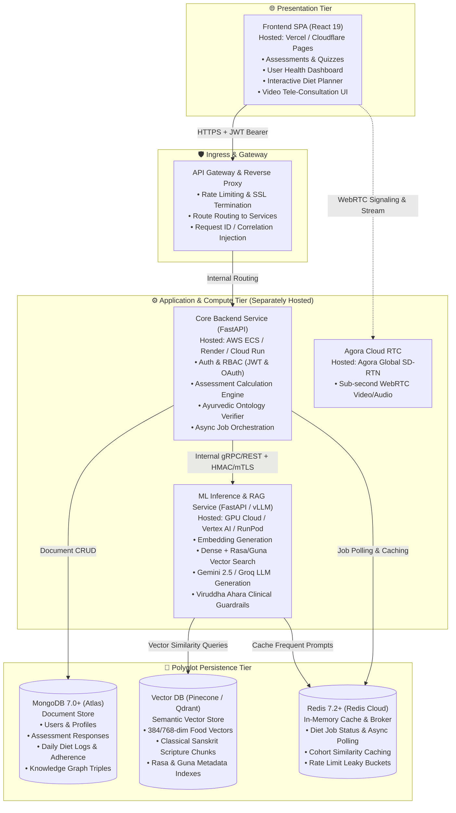
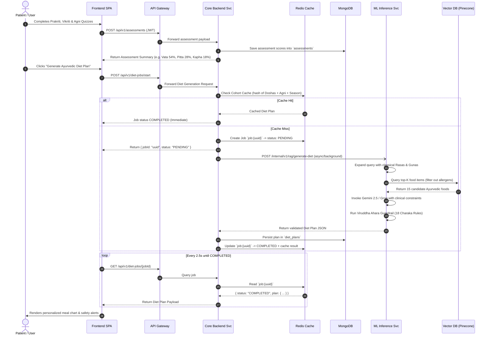

# AyurVarta — Distributed System Architecture & Polyglot Persistence Overview

> **Architecture Style**: Microservices & Polyglot Persistence  
> **Target Environment**: Production Distributed Cloud  
> **Status**: Verified Specification  
> **Last Updated**: November 2026  

---

## 1. High-Level Distributed Architecture

AyurVarta is split into discrete, purpose-built distributed services to guarantee high availability, strict separation of concerns, and optimized compute resource allocation:



---

## 2. Why Polyglot Persistence?

Ayurvedic digital healthcare requires handling three completely different types of data shapes and query patterns. A single database cannot optimize for all three without severe trade-offs.

| Database Engine | Data Type / Model | Why It Is Used in AyurVarta | Stored Collections / Keys |
| :--- | :--- | :--- | :--- |
| **MongoDB Atlas** | Document / JSON Hierarchical & Graph Triples | Assessment answer trees, user health profiles, and dietary history have variable schemas and nested objects. Flexible schema allows painless evolution of quiz questionnaires without migrations. Also stores subject-predicate-object knowledge triples (`kg_entities`, `kg_relations`). | `users`, `assessments`, `diet_plans`, `diet_logs`, `kg_entities`, `kg_relations` |
| **Pinecone / Qdrant** | High-Dimensional Dense & Sparse Vectors | Enables semantic search over classical Ayurvedic dietary items based on natural language queries, clinical conditions, tastes (*Rasas*), and elemental qualities (*Gunas*). Metadata filtering allows instant elimination of patient food allergens. | `ayurvedic-foods-v2` index (with namespaces for food items and scripture passages) |
| **Redis** | In-Memory Key-Value & Atomic Data Structures | Generation of custom diet plans takes 4–12 seconds via LLMs. Storing job state (`PENDING`, `PROCESSING`, `COMPLETED`, `FAILED`) in Redis enables sub-millisecond polling for the frontend. Redis also caches similar cohort diets (e.g. "Vata-dominant + Manda Agni in Grishma season") to avoid redundant LLM invocations. | `job:{jobId}`, `cohort:{hash}`, `ratelimit:{ip}:{minute}`, `token:denylist:{jti}` |

---

## 3. Distributed Service Boundaries

Each service in the architecture owns its exclusive boundary and runtime:

```
┌────────────────────────────────────────────────────────────────────────┐
│                          AyurVarta Platform                            │
├─────────────────────┬──────────────────────┬───────────────────────────┤
│ Service             │ Boundary Ownership   │ Prohibited Activities     │
├─────────────────────┼──────────────────────┼───────────────────────────┤
│ Frontend SPA        │ Presentation, User   │ Direct database calls,    │
│                     │ Interaction, WebRTC  │ Direct LLM API keys in    │
│                     │ client handling.     │ client code (in prod).    │
├─────────────────────┼──────────────────────┼───────────────────────────┤
│ Core Backend        │ Business logic, auth │ Running heavy GPU LLM     │
│                     │ validation, workflow │ inference or raw vector   │
│                     │ orchestration.       │ distance calculations.    │
├─────────────────────┼──────────────────────┼───────────────────────────┤
│ ML Inference        │ Vector retrieval,    │ Direct user auth, user    │
│                     │ LLM generation,      │ profile editing, managing │
│                     │ clinical guardrails. │ payment transactions.     │
└─────────────────────┴──────────────────────┴───────────────────────────┘
```

---

## 4. End-to-End User Flow: Clinical Diet Plan Generation

Here is how all distributed components collaborate during a complete diet generation lifecycle:



---

## 5. Security & Distributed Tracing

1. **Request Correlation ID**: Every inbound HTTP request at the API Gateway receives an `X-Request-Id` (e.g., `req_8f12a84c`). This header is propagated across Core Backend, Redis, ML Service, and in every structured log line.
2. **Internal Service Authentication**: The ML service is not exposed to the public internet. It accepts incoming traffic only from the Core Backend IP/VPC with an `X-Internal-Service-Key` HMAC header.
3. **Secrets Management**: All third-party secrets (`GEMINI_API_KEY`, `PINECONE_API_KEY`, `MONGODB_URI`, `REDIS_URL`, `AGORA_APP_CERTIFICATE`) are injected at runtime via environment variables or secret managers (AWS Secrets Manager, GCP Secret Manager, or Doppler).
