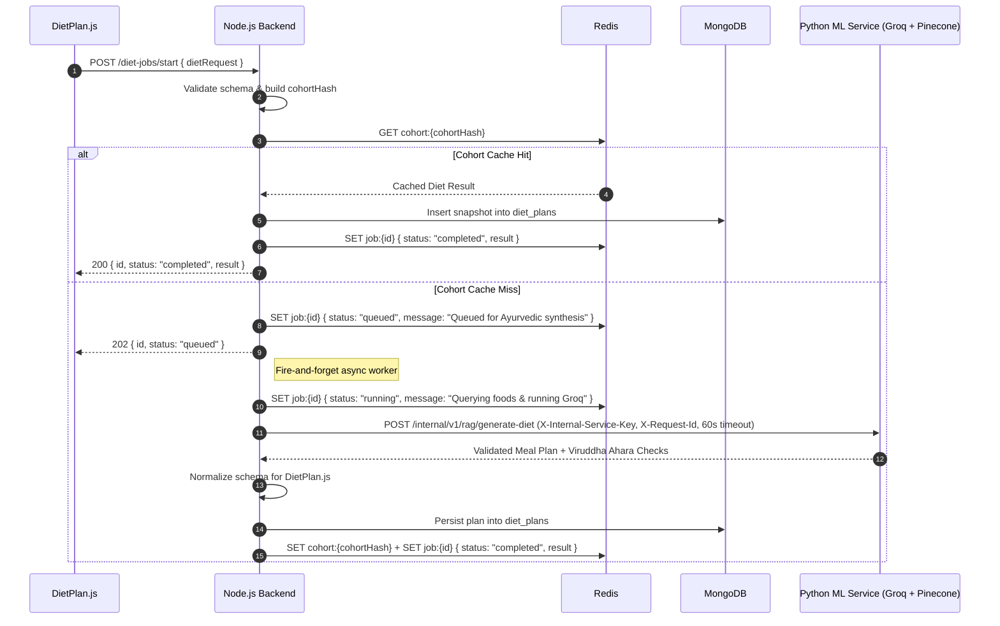

# AyurVarta — Node.js Core Backend Implementation Plan (`backend/`)

> **Target Service**: `core-backend-service` ([`backend/`](../../backend))  
> **Runtime**: Node.js 20+ (LTS, ES Modules) + Express.js  
> **Persistence**: MongoDB (Primary Document Store) + Redis (Job State, Cohort Cache, Rate Limiter, Token Denylist)  
> **AI Integration**: Separately Hosted Python ML Service (`ml-service`) + Groq Inference (`llama-3.3-70b-versatile` / `openai/gpt-oss-120b`)  
> **Compliance**: Aligned with [`Vibe_Rules.md`](../../Vibe_Rules.md) & [`PROJECT_RULES.md`](../../PROJECT_RULES.md)

---

## 1. Executive Summary & Architectural Role

In AyurVarta's distributed architecture, the **Node.js Core Backend** acts as the **API Gateway, Business Orchestrator, and Security Boundary** between the React 19 SPA, the polyglot databases (MongoDB & Redis), and the Python ML Inference Service (`ml-service`).

The backend **does not** execute Python ML pipelines or vector distance math directly. Instead, it owns:
1. **Identity, Auth & RBAC**: JWT access/refresh rotation, bcrypt password hashing, Google OAuth verification, audit logging, and resource ownership enforcement.
2. **Frontend Contract Fulfillment**: Serving every API consumed by `frontend/src/api/` and `frontend/src/firebase/auth.js`.
3. **Clinical Assessment Persistence**: Validating and storing Prakriti, Vikriti, and Agni scores and Ayurvedic disease flags in MongoDB.
4. **Async Diet Job Orchestration**: Managing non-blocking diet generation jobs in Redis (`queued` → `running` → `completed` / `failed`), checking cohort caches, dispatching work to `ml-service`, and normalizing responses for the UI.
5. **Adherence & Telehealth Authority**: Daily meal compliance CRUD (`diet_logs`), server-side Groq chat proxy (`/api/v1/ai/chat`), and Agora RTC token signing.

---

## 2. Target Module Structure (`backend/src/`)

```text
backend/
├── package.json
├── Dockerfile
├── .env.example
└── src/
    ├── server.js                      # Express bootstrap, middleware wiring, graceful shutdown
    ├── config/
    │   └── index.js                   # Typed env loader & startup invariant checks
    ├── db/
    │   ├── mongo.js                   # MongoDB singleton pool + automated index creation
    │   └── redis.js                   # ioredis client + reconnect/error handling
    ├── middleware/
    │   ├── correlation.js             # X-Request-Id injection & structured request logging
    │   ├── auth.js                    # JWT verification, Redis denylist check & RBAC guards
    │   ├── rateLimiter.js             # Redis sliding-window rate limiter (IP & User scopes)
    │   ├── validate.js                # Request body/query/params schema validation middleware
    │   └── errorHandler.js            # Standardized Vibe Rules JSON error envelope
    ├── schemas/
    │   ├── auth.schema.js             # Signup, login, google oauth, forgot-password rules
    │   ├── assessment.schema.js       # Prakriti, Vikriti, Agni score bounds & types
    │   ├── diet.schema.js             # Diet preferences, job start, meal adherence log rules
    │   └── ai.schema.js               # Chat message array & temperature bounds
    ├── services/
    │   ├── auth.service.js            # Bcrypt hashing, JWT signing, refresh rotation, Google verify
    │   ├── assessment.service.js      # Dosha normalization, latest snapshot aggregation
    │   ├── dietJob.service.js         # Cohort hashing, Redis job state machine, ML dispatch
    │   ├── dietLog.service.js         # Meal adherence analytics & MongoDB CRUD
    │   ├── mlClient.service.js        # Internal HTTP client to ml-service (HMAC + retries)
    │   ├── groqProxy.service.js       # Direct/proxied Groq chat completions for Chatbot/PersonalAI
    │   ├── telehealth.service.js      # Agora RtcTokenBuilder signing
    │   └── audit.service.js           # Security audit event writer (login, logout, password reset)
    ├── routes/
    │   ├── health.routes.js           # GET /health, GET /ready (real Mongo + Redis pings)
    │   ├── auth.routes.js             # /auth/* & /api/v1/auth/*
    │   ├── assessment.routes.js       # /assessments/* & /api/v1/assessments/*
    │   ├── diet.routes.js             # /diet-jobs/*, /generate-diet-plan, /diet-logs/*
    │   ├── ai.routes.js               # /api/v1/ai/chat, /api/v1/ai/advice
    │   └── telehealth.routes.js       # /api/v1/telehealth/token
    └── tests/
        ├── auth.test.js
        ├── assessments.test.js
        ├── dietJobs.test.js
        └── dietLogs.test.js
```

---

## 3. Exact Frontend-to-Backend API Contract Matrix

Every endpoint below maps directly to existing calls in [`frontend/src/`](../../frontend/src) so the React app connects without breaking changes.

> **Versioning Strategy**: Mount routers under `/api/v1/*` as the canonical specification, and mount root compatibility aliases (`/auth/*`, `/assessments/*`, `/diet-jobs/*`, `/diet-logs/*`, `/generate-diet-plan`) so existing `setupProxy.js` and frontend API clients work immediately.

### 3.1 Authentication (`/api/v1/auth` & `/auth`)
| Method | Endpoint | Consumer (`frontend`) | Request Body | Response Shape & Notes |
| :---: | :--- | :--- | :--- | :--- |
| `POST` | `/auth/signup` | `firebase/auth.js` | `{ email, password, displayName, role }` | `201`: `{ token, user: { id, email, displayName, role, provider: "local" } }` + sets refresh cookie. |
| `POST` | `/auth/login` | `firebase/auth.js` | `{ email, password }` | `200`: `{ token, user }` (non-leaky error `"Invalid email or password"` on mismatch). |
| `POST` | `/auth/google` | `firebase/auth.js` | `{ idToken, role }` | `200`: Verifies Google JWT, upserts user, returns `{ token, user }`. |
| `POST` | `/auth/logout` | `firebase/auth.js` | `Bearer <token>` | `200`: Writes JWT `jti` to Redis denylist (`token:denylist:{jti}`), revokes refresh token. |
| `POST` | `/auth/refresh` | Auth Refresh | `httpOnly` cookie or `{ refreshToken }` | `200`: Rotates refresh token and issues fresh short-lived access JWT. |
| `POST` | `/auth/forgot-password` | `firebase/auth.js` | `{ email }` | `200`: Always returns generic success (prevents email enumeration); generates expiring 1-time reset token. |
| `GET` | `/auth/me` | `firebase/auth.js` | `Bearer <token>` | `200`: `{ user: { id, email, displayName, role, provider } }`. |

### 3.2 Constitutional Assessments (`/api/v1/assessments` & `/assessments`)
| Method | Endpoint | Consumer (`frontend`) | Request Body | Response Shape & Notes |
| :---: | :--- | :--- | :--- | :--- |
| `POST` | `/assessments` | `api/assessment.js` | `{ type, scores, schema, disease, capturedAt }` | Validates `type ∈ ['prakriti','vikriti','agni']`; saves to `assessments` collection; returns saved record. |
| `GET` | `/assessments/latest` | `api/assessment.js` | Query / `Bearer <token>` | Aggregates latest record per assessment type (`{ prakriti, vikriti, agni }`) for the signed-in user. |

### 3.3 Diet Generation Jobs & Sync Fallback (`/api/v1/diet-jobs`, `/diet-jobs`, `/generate-diet-plan`)
| Method | Endpoint | Consumer (`frontend`) | Request / Params | Response Shape & Notes |
| :---: | :--- | :--- | :--- | :--- |
| `POST` | `/diet-jobs/start` | `api/diet.js`, `DietPlan.js` | `{ dietRequest: { profile, health, dietPreferences, environment, goals } }` | Checks Redis cohort cache. On hit: stores completed job and returns `{ id, status: "completed", result }`. On miss: sets Redis `queued`, dispatches async call to `ml-service`, returns `202 { id, status: "queued", message }`. |
| `GET` | `/diet-jobs/latest` | `api/diet.js`, `DietPlan.js` | `Bearer <token>` | Returns latest active/completed job for user, or `{ status: "none" }` if none exists. |
| `GET` | `/diet-jobs/:jobId` | `api/diet.js`, `DietPlan.js` | `:jobId` | Reads `job:{jobId}` from Redis (fallback to MongoDB `diet_plans`). Status values strictly match UI poller: `'queued' \| 'running' \| 'completed' \| 'failed'`. |
| `POST` | `/generate-diet-plan` | `api/diet.js` | `{ profile, health, dietPreferences, environment, goals }` | Synchronous wrapper calling `ml-service` directly with 60s timeout. |

### 3.4 Meal Adherence Logs (`/api/v1/diet-logs` & `/diet-logs`)
| Method | Endpoint | Consumer (`frontend`) | Request / Params | Response Shape & Notes |
| :---: | :--- | :--- | :--- | :--- |
| `POST` | `/diet-logs` | `api/diet.js`, `DietPlan.js` | `{ mealType, mealName, notes, adherence }` | Enforces `adherence ∈ [1..5]`; saves to `diet_logs`; returns `{ id, mealType, mealName, notes, adherence, createdAt }`. |
| `GET` | `/diet-logs?limit=30` | `api/diet.js`, `DietPlan.js` | `limit` (max 100) | Returns `{ items: [...] }` sorted by `createdAt DESC`, scoped strictly to `req.user.id`. |
| `DELETE` | `/diet-logs/:logId` | `api/diet.js`, `DietPlan.js` | `:logId` | Enforces ownership (`userId === req.user.id`); deletes record or returns `404`. |

### 3.5 Groq AI Proxy & Telehealth Authority
| Method | Endpoint | Consumer (`frontend`) | Request Body | Response Shape & Notes |
| :---: | :--- | :--- | :--- | :--- |
| `POST` | `/api/v1/ai/chat` | `api/ai.js` (`Chatbot`, `PersonalAI`) | `{ messages, systemPrompt, temperature, maxTokens }` | Keeps `GROQ_API_KEY` off the client; calls Groq `llama-3.3-70b-versatile` (or proxies via `ml-service`) and returns `{ success: true, data: { reply, model } }`. |
| `POST` | `/api/v1/telehealth/token` | `VideoConsultation.js` | `{ channelName, role }` | Uses `agora-access-token` to mint a 1-hour RTC token with `AGORA_APP_ID` + `AGORA_APP_CERTIFICATE`. |

---

## 4. Polyglot Data & Caching Architecture inside `backend`

### 4.1 MongoDB Collections & Indexes (`src/db/mongo.js`)
On application boot, `ensureIndexes()` idempotently establishes all constraints required by `Vibe_Rules.md` Phase 7:
- `users`: `{ email: 1 }` (**Unique**), `{ createdAt: -1 }`
- `refresh_tokens`: `{ tokenHash: 1 }` (**Unique**), `{ expiresAt: 1 }` (**TTL `expireAfterSeconds: 0`**)
- `assessments`: `{ userId: 1, type: 1, capturedAt: -1 }` (**Compound**)
- `diet_plans`: `{ userId: 1, createdAt: -1 }` (**Compound**), `{ jobId: 1 }` (**Unique Sparse**)
- `diet_logs`: `{ userId: 1, createdAt: -1 }` (**Compound**)
- `audit_logs`: `{ userId: 1, timestamp: -1 }`, `{ timestamp: 1 }` (**TTL 90 days**)

### 4.2 Redis Key Lifecycle (`src/db/redis.js`)
| Key Pattern | TTL | Purpose |
| :--- | :--- | :--- |
| `job:{jobId}` | `24h` | JSON state (`id`, `userId`, `status`, `message`, `result`, `error`) polled every 2.5s by `DietPlan.js`. |
| `cohort:{sha256}` | `7d` | Deterministic hash of `(dominantPrakriti, vikritiProfile, agni, dietType, sortedAllergies, season)` caching safe plan templates to skip redundant LLM generation. |
| `ratelimit:{scope}:{id}` | `60s–900s` | Protects `/auth/login` (10/15m per IP), `/auth/signup` (5/15m per IP), and `/diet-jobs/start` (10/1h per user). |
| `token:denylist:{jti}` | `<= 30m` | Immediately invalidates logged-out JWT access tokens in RAM. |

---

## 5. Asynchronous Diet Generation Workflow (`dietJob.service.js`)



---

## 6. Phased Execution Roadmap (6 Sprints)

| Phase | Scope | Deliverables & Acceptance Criteria |
| :---: | :--- | :--- |
| **Phase 1: Core Infra & Validation** | DB connections, Middleware, Config | • `db/mongo.js` & `db/redis.js` with real `/ready` pings.<br>• Standardized error & success envelopes (`PROJECT_RULES.md`).<br>• Request validation middleware & structured JSON logging with `X-Request-Id`. |
| **Phase 2: Auth, RBAC & Security** | Identity & Audit Logs | • `POST /auth/signup`, `/login`, `/google`, `/logout`, `/refresh`, `/me`, `/forgot-password`.<br>• Bcrypt hashing (12 rounds), JWT access (`30m`) + refresh rotation (`7d`).<br>• Redis rate limiter + token denylist + MongoDB `audit_logs`. |
| **Phase 3: Assessments Engine** | Diagnostic Persistence | • `POST /assessments` & `GET /assessments/latest`.<br>• Server-side Dosha percentage & Agni classification sanity checks.<br>• Strict per-user scoping (zero IDOR vulnerabilities). |
| **Phase 4: Diet Jobs & ML Bridge** | Async Queue & Groq RAG Dispatch | • `POST /diet-jobs/start`, `GET /diet-jobs/:jobId`, `GET /diet-jobs/latest`, `POST /generate-diet-plan`.<br>• Cohort cache lookup (`cohort:{hash}`) + `mlClient.service.js` with retry/circuit-breaker.<br>• Schema normalizer matching `DietPlan.js` UI structures. |
| **Phase 5: Logs, Groq Proxy & Agora** | Adherence, AI Chat & Video | • `POST/GET/DELETE /diet-logs` with ownership check & `1-5` adherence validation.<br>• `POST /api/v1/ai/chat` server-side Groq chat proxy.<br>• `POST /api/v1/telehealth/token` Agora RTC token generator. |
| **Phase 6: Testing & Hardening** | Quality & Observability | • Integration tests (`node --test`) covering auth, assessments, jobs, and logs.<br>• OpenAPI 3.0 specification served at `/api/docs`.<br>• End-to-end verification via `docker-compose up --build`. |

---

## 7. Dependencies Audit (Per `Vibe_Rules.md` Phase 1)

Already installed in [`backend/package.json`](../../backend/package.json):
- `express`, `cors`, `helmet`, `dotenv`, `mongodb`, `ioredis`, `jsonwebtoken`, `bcryptjs`, `axios`, `agora-access-token`

Proposed lightweight additions to approve before Phase 1–6 implementation:
1. **`zod`**: Runtime request schema validation with clean field-level error reporting for `error.details`.
2. **`google-auth-library`**: Official cryptographic verification of Google Sign-In `idToken` payloads for `/auth/google`.
3. **`express-rate-limit` + `rate-limit-redis`** (or custom pure `ioredis` sliding-window script using zero extra deps).
4. **`pino` + `pino-http`**: Fast structured JSON logging automatically capturing `X-Request-Id` without leaking secrets.
