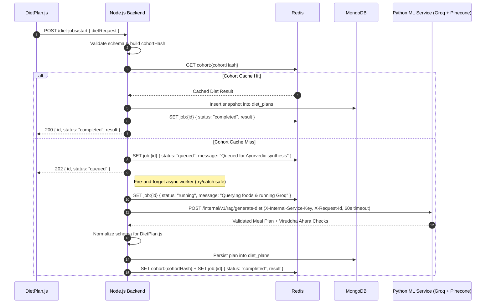

# AyurVarta — Node.js Core Backend Implementation Plan (`backend/`)

> **Target Service**: `core-backend-service` ([`backend/`](../../backend))  
> **Runtime**: Node.js 20+ (LTS, ES Modules) + Express.js  
> **Observability**: **`winston`** + **`morgan`** + **`chalk`** (Unified, color-coded, secret-redacted HTTP & application logging)  
> **Persistence**: MongoDB (Primary Document Store) + Redis (Job State, Cohort Cache, Rate Limiter, Token Denylist)  
> **AI Integration**: Separately Hosted Python ML Service (`ml-service`) + Groq Inference (`llama-3.3-70b-versatile` / `openai/gpt-oss-120b`)  
> **Compliance**: Aligned with [`Vibe_Rules.md`](../../Vibe_Rules.md) & [`PROJECT_RULES.md`](../../PROJECT_RULES.md)

---

## 1. Executive Summary & Architectural Role

In AyurVarta's distributed architecture, the **Node.js Core Backend** acts as the **API Gateway, Business Orchestrator, and Security Boundary** between the React 19 SPA, the polyglot databases (MongoDB & Redis), and the Python ML Inference Service (`ml-service`).

The backend **does not** execute Python ML pipelines or vector distance math directly. Instead, it owns:
1. **Identity, Auth & RBAC**: JWT access/refresh rotation, bcrypt password hashing, Google OAuth verification, audit logging, and resource ownership enforcement.
2. **Frontend Contract Fulfillment**: Serving every API consumed by `frontend/src/api/` and `frontend/src/firebase/auth.js`.
3. **Clinical Assessment Persistence**: Validating and storing Prakriti, Vikriti, and Agni scores and Ayurvedic disease flags in MongoDB.
4. **Async Diet Job Orchestration**: Managing non-blocking diet generation jobs in Redis (`queued` → `running` → `completed` / `failed`), checking cohort caches, dispatching work to `ml-service`, and normalizing responses for the UI.
5. **Adherence & Telehealth Authority**: Daily meal compliance CRUD (`diet_logs`), server-side Groq chat proxy (`/api/v1/ai/chat`), and Agora RTC token signing.
6. **Readable Observability**: Unified request + lifecycle logging powered by **`morgan`**, **`winston`**, and **`chalk`** with `X-Request-Id` correlation and automatic secret redaction.

---

## 2. Target Module Structure (`backend/src/`)

Each module below is tagged with the exact phase that introduces it so no half-wired imports ever exist in the running codebase:

```text
backend/
├── package.json
├── Dockerfile
├── .env.example
└── src/
    ├── server.js                      # [Phase 1+] Express bootstrap, middleware wiring, graceful shutdown
    ├── config/
    │   └── index.js                   # [Phase 1]  Zod-validated env loader & startup invariant checks
    ├── utils/
    │   └── logger.js                  # [Phase 1]  Winston + Chalk formatter, secret redaction & Morgan stream
    ├── db/
    │   ├── mongo.js                   # [Phase 2]  MongoDB singleton pool + idempotent index creation
    │   └── redis.js                   # [Phase 2]  ioredis client + explicit error/reconnect handlers
    ├── middleware/
    │   ├── correlation.js             # [Phase 1]  X-Request-Id injection (header-safe timing)
    │   ├── requestLogger.js           # [Phase 1]  Morgan HTTP logger piped into Winston + Chalk
    │   ├── validate.js                # [Phase 1]  Zod schema validation (body/query/params)
    │   ├── notFound.js                # [Phase 1]  404 JSON envelope handler
    │   ├── errorHandler.js            # [Phase 1]  Standardized Vibe Rules JSON error envelope
    │   ├── auth.js                    # [Phase 3]  JWT verification, Redis denylist check & RBAC guards
    │   └── rateLimiter.js             # [Phase 3]  Pure ioredis sliding-window rate limiter (IP & User)
    ├── schemas/
    │   ├── auth.schema.js             # [Phase 3]  Signup, login, Google OAuth, refresh, forgot-password
    │   ├── assessment.schema.js       # [Phase 4]  Prakriti, Vikriti, Agni score bounds & types
    │   ├── diet.schema.js             # [Phase 5/6] Diet preferences, job start, meal adherence log rules
    │   └── ai.schema.js               # [Phase 7]  Groq chat messages & Agora telehealth token rules
    ├── services/
    │   ├── auth.service.js            # [Phase 3]  Bcrypt hashing, JWT signing, refresh rotation, Google verify
    │   ├── audit.service.js           # [Phase 3]  Security audit event writer (MongoDB + Winston)
    │   ├── assessment.service.js      # [Phase 4]  Dosha normalization, Agni classify, latest snapshot
    │   ├── mlClient.service.js        # [Phase 5]  Internal HTTP client to ml-service (HMAC + retries)
    │   ├── dietJob.service.js         # [Phase 5]  Cohort hashing, Redis job state machine, ML dispatch
    │   ├── dietLog.service.js         # [Phase 6]  Meal adherence analytics & ownership-scoped MongoDB CRUD
    │   ├── groqProxy.service.js       # [Phase 7]  Server-side Groq chat completions proxy
    │   └── telehealth.service.js      # [Phase 7]  Agora RtcTokenBuilder signing
    ├── routes/
    │   ├── health.routes.js           # [Phase 1/2] GET /health, GET /api/v1/status, real GET /ready
    │   ├── auth.routes.js             # [Phase 3]  /auth/* & /api/v1/auth/*
    │   ├── assessment.routes.js       # [Phase 4]  /assessments/* & /api/v1/assessments/*
    │   ├── diet.routes.js             # [Phase 5/6] /diet-jobs/*, /generate-diet-plan, /diet-logs/*
    │   ├── ai.routes.js               # [Phase 7]  /api/v1/ai/chat, /api/v1/ai/advice
    │   ├── telehealth.routes.js       # [Phase 7]  /api/v1/telehealth/token
    │   └── docs.routes.js             # [Phase 8]  GET /api/docs (OpenAPI 3.0 spec & UI)
    └── tests/
        ├── health.test.js             # [Phase 1]  Gateway, logging, correlation & error envelope smoke tests
        ├── auth.test.js               # [Phase 3]  Auth lifecycle, denylist & rate-limit tests
        ├── assessments.test.js        # [Phase 4]  Assessment scoring & IDOR prevention tests
        ├── dietJobs.test.js           # [Phase 5]  Cohort cache, job state machine & ML failure tests
        ├── dietLogs.test.js           # [Phase 6]  Meal log CRUD & ownership tests
        └── aiTelehealth.test.js       # [Phase 7]  Groq proxy & Agora token tests
```

---

## 3. Logging & Observability Architecture (`chalk` + `winston` + `morgan`)

To make backend logs both **human-delightful during local development** and **structured & safe in production**, all logging flows through a single unified pipeline — **no raw `console.log` calls anywhere in `src/`**.

### 3.1 How `morgan`, `winston`, and `chalk` Work Together

```text
Inbound HTTP Request
  │
  ▼
correlationMiddleware          ──► Injects req.requestId + sets X-Request-Id response header
  │
  ▼
morgan (requestLogger.js)      ──► Formats method, URL, status, ms, requestId, userId
  │                                  │
  │                                  ▼ (stream.write)
  │                             logger.http(...)
  ▼                                  │
Route Handler / Service        ──────┼──► winston (logger.js)
                                     │      1. Attach timestamp + context tag
                                     │      2. Redact secrets (password, token, API keys)
                                     │      3. Console Transport:
                                     │         • LOG_FORMAT=pretty ──► chalk colorized line
                                     │         • LOG_FORMAT=json   ──► single-line JSON
                                     │      4. Optional File Transport (LOG_TO_FILE=true):
                                     │         • logs/combined.log + logs/error.log (JSON)
                                     ▼
                              Clean Terminal / Log Stream
```

### 3.2 Visual Terminal Output Design (`LOG_FORMAT=pretty`)

`chalk` v5 (native ESM) formats every log line into aligned, scannable columns:
- **Timestamp**: Dim gray (`HH:mm:ss.SSS`)
- **Level Badge**:
  - `ERROR` → Bold white on red (`chalk.bgRed.white.bold`) or bright red
  - `WARN`  → Bold yellow (`chalk.yellow.bold`)
  - `INFO`  → Bold cyan/green (`chalk.cyan.bold`)
  - `HTTP`  → Bold magenta (`chalk.magenta.bold`)
  - `DEBUG` → Dim blue/gray (`chalk.gray`)
- **Correlation ID**: Cyan bracketed tag (`[req_9f2a1c]`)
- **HTTP Methods (`morgan`)**: `GET` green, `POST` blue, `PUT`/`PATCH` yellow, `DELETE` red
- **Status Codes (`morgan`)**: `2xx` bright green, `3xx` cyan, `4xx` yellow, `5xx` bright red bold
- **Latency (`morgan`)**: Dim gray under 200ms, yellow 200–1000ms, red above 1000ms

Example boot & request stream in terminal:

```text
────────────────────────────────────────────────────────────────────
  AyurVarta Core Backend  v1.0.0  [development]
  Server   : http://0.0.0.0:8000
  Health   : http://localhost:8000/health
  Ready    : http://localhost:8000/ready
  MongoDB  : connected (ayurvarta)
  Redis    : connected (localhost:6379)
  ML Svc   : http://localhost:8001
────────────────────────────────────────────────────────────────────
22:55:01.142  INFO   [boot]       MongoDB indexes verified across 6 collections
22:55:04.819  HTTP   [req_9f2a1c] POST   /api/v1/auth/login       200   18.4 ms  user=usr_42
22:55:07.302  HTTP   [req_4b8e0d] POST   /api/v1/diet-jobs/start  202    6.1 ms  cohort=miss
22:55:07.305  INFO   [diet-job]   [req_4b8e0d] Dispatched job_881a to ml-service
22:55:09.914  WARN   [rate-limit] [req_7c1d9e] Approaching limit 8/10 on /auth/login ip=127.0.0.1
22:55:11.044  ERROR  [ml-client]  [req_4b8e0d] ml-service timeout after 60000ms
```

### 3.3 Mandatory Logging Rules (`Vibe_Rules.md` Phase 8 & Bug Fix)

1. **Secret Redaction Transform**: A custom `winston.format` recursively masks keys matching `/password|token|authorization|secret|apikey|certificate|cookie/i` with `"[REDACTED]"` before writing to console or disk.
2. **Fix Existing `correlation.js` Header Bug**: The current stub in `backend/src/middleware/correlation.js` calls `res.setHeader('X-Process-Time', ...)` inside `res.on('finish')`, which throws `ERR_HTTP_HEADERS_SENT` after response headers are flushed. Phase 1 replaces this with `morgan`'s `:response-time` logging and header-safe timing (only setting headers before `writeHead` / `end`), eliminating any crash on request completion.
3. **Environment Modes**:
   - `development`: `LOG_LEVEL=debug`, `LOG_FORMAT=pretty` (`chalk` enabled).
   - `test`: `LOG_LEVEL=error` (keeps `node --test` output crisp and readable).
   - `production`: `LOG_LEVEL=info`, `LOG_FORMAT=json` (clean structured JSON for cloud/Docker collectors; override with `LOG_FORMAT=pretty` for local Docker inspection).

---

## 4. Exact Frontend-to-Backend API Contract Matrix

Every endpoint below maps directly to existing calls in [`frontend/src/`](../../frontend/src) so the React app connects without breaking changes.

> **Versioning Strategy**: Mount routers under `/api/v1/*` as the canonical specification, and mount root compatibility aliases (`/auth/*`, `/assessments/*`, `/diet-jobs/*`, `/diet-logs/*`, `/generate-diet-plan`) so existing `setupProxy.js` and frontend API clients work immediately.

### 4.1 Authentication (`/api/v1/auth` & `/auth`)
| Method | Endpoint | Consumer (`frontend`) | Request Body | Response Shape & Notes |
| :---: | :--- | :--- | :--- | :--- |
| `POST` | `/auth/signup` | `firebase/auth.js` | `{ email, password, displayName, role }` | `201`: `{ token, user: { id, email, displayName, role, provider: "local" } }` + sets `httpOnly` refresh cookie. |
| `POST` | `/auth/login` | `firebase/auth.js` | `{ email, password }` | `200`: `{ token, user }` (non-leaky error `"Invalid email or password"` on mismatch). |
| `POST` | `/auth/google` | `firebase/auth.js` | `{ idToken, role }` | `200`: Verifies Google JWT, upserts user, returns `{ token, user }`. |
| `POST` | `/auth/logout` | `firebase/auth.js` | `Bearer <token>` | `200`: Writes JWT `jti` to Redis denylist (`token:denylist:{jti}`), revokes refresh token. |
| `POST` | `/auth/refresh` | Auth Refresh | `httpOnly` cookie or `{ refreshToken }` | `200`: Rotates refresh token and issues fresh short-lived access JWT. |
| `POST` | `/auth/forgot-password` | `firebase/auth.js` | `{ email }` | `200`: Always returns generic success (prevents email enumeration); generates expiring 1-time reset token. |
| `GET` | `/auth/me` | `firebase/auth.js` | `Bearer <token>` | `200`: `{ user: { id, email, displayName, role, provider } }`. |

### 4.2 Constitutional Assessments (`/api/v1/assessments` & `/assessments`)
| Method | Endpoint | Consumer (`frontend`) | Request Body | Response Shape & Notes |
| :---: | :--- | :--- | :--- | :--- |
| `POST` | `/assessments` | `api/assessment.js` | `{ type, scores, schema, disease, capturedAt }` | Validates `type ∈ ['prakriti','vikriti','agni']`; saves to `assessments` collection; returns saved record. |
| `GET` | `/assessments/latest` | `api/assessment.js` | Query / `Bearer <token>` | Aggregates latest record per assessment type (`{ prakriti, vikriti, agni }`) for the signed-in user. |

### 4.3 Diet Generation Jobs & Sync Fallback (`/api/v1/diet-jobs`, `/diet-jobs`, `/generate-diet-plan`)
| Method | Endpoint | Consumer (`frontend`) | Request / Params | Response Shape & Notes |
| :---: | :--- | :--- | :--- | :--- |
| `POST` | `/diet-jobs/start` | `api/diet.js`, `DietPlan.js` | `{ dietRequest: { profile, health, dietPreferences, environment, goals } }` | Checks Redis cohort cache. On hit: stores completed job and returns `200 { id, status: "completed", result }`. On miss: sets Redis `queued`, dispatches async call to `ml-service`, returns `202 { id, status: "queued", message }`. |
| `GET` | `/diet-jobs/latest` | `api/diet.js`, `DietPlan.js` | `Bearer <token>` | Returns latest active/completed job for user, or `{ status: "none" }` if none exists. |
| `GET` | `/diet-jobs/:jobId` | `api/diet.js`, `DietPlan.js` | `:jobId` | Reads `job:{jobId}` from Redis (fallback to MongoDB `diet_plans`). Status values strictly match UI poller: `'queued' \| 'running' \| 'completed' \| 'failed'`. |
| `POST` | `/generate-diet-plan` | `api/diet.js` | `{ profile, health, dietPreferences, environment, goals }` | Synchronous wrapper calling `ml-service` directly with 60s timeout. |

### 4.4 Meal Adherence Logs (`/api/v1/diet-logs` & `/diet-logs`)
| Method | Endpoint | Consumer (`frontend`) | Request / Params | Response Shape & Notes |
| :---: | :--- | :--- | :--- | :--- |
| `POST` | `/diet-logs` | `api/diet.js`, `DietPlan.js` | `{ mealType, mealName, notes, adherence }` | Enforces `adherence ∈ [1..5]`; saves to `diet_logs`; returns `{ id, mealType, mealName, notes, adherence, createdAt }`. |
| `GET` | `/diet-logs?limit=30` | `api/diet.js`, `DietPlan.js` | `limit` (max 100) | Returns `{ items: [...] }` sorted by `createdAt DESC`, scoped strictly to `req.user.id`. |
| `DELETE` | `/diet-logs/:logId` | `api/diet.js`, `DietPlan.js` | `:logId` | Enforces ownership (`userId === req.user.id`); deletes record or returns `404`. |

### 4.5 Groq AI Proxy & Telehealth Authority
| Method | Endpoint | Consumer (`frontend`) | Request Body | Response Shape & Notes |
| :---: | :--- | :--- | :--- | :--- |
| `POST` | `/api/v1/ai/chat` | `api/ai.js` (`Chatbot`, `PersonalAI`) | `{ messages, systemPrompt, temperature, maxTokens }` | Keeps `GROQ_API_KEY` off the client; calls Groq `llama-3.3-70b-versatile` and returns `{ success: true, data: { reply, model } }`. |
| `POST` | `/api/v1/ai/advice` | `api/ai.js` | `{ userContext, preamble }` | Server-side wrapper generating personalized Ayurvedic advice summary via Groq. |
| `POST` | `/api/v1/telehealth/token` | `VideoConsultation.js` | `{ channelName, role }` | Uses `agora-access-token` to mint a 1-hour RTC token with `AGORA_APP_ID` + `AGORA_APP_CERTIFICATE`. |

---

## 5. Polyglot Data & Caching Architecture inside `backend`

### 5.1 MongoDB Collections & Indexes (`src/db/mongo.js`)
On application boot, `ensureIndexes()` idempotently establishes all constraints required by `Vibe_Rules.md` Phase 7:
- `users`: `{ email: 1 }` (**Unique**), `{ createdAt: -1 }`
- `refresh_tokens`: `{ tokenHash: 1 }` (**Unique**), `{ expiresAt: 1 }` (**TTL `expireAfterSeconds: 0`**)
- `assessments`: `{ userId: 1, type: 1, capturedAt: -1 }` (**Compound**)
- `diet_plans`: `{ userId: 1, createdAt: -1 }` (**Compound**), `{ jobId: 1 }` (**Unique Sparse**)
- `diet_logs`: `{ userId: 1, createdAt: -1 }` (**Compound**)
- `audit_logs`: `{ userId: 1, timestamp: -1 }`, `{ timestamp: 1 }` (**TTL 90 days**)

### 5.2 Redis Key Lifecycle (`src/db/redis.js`)
| Key Pattern | TTL | Purpose |
| :--- | :--- | :--- |
| `job:{jobId}` | `24h` | JSON state (`id`, `userId`, `status`, `message`, `result`, `error`) polled every 2.5s by `DietPlan.js`. |
| `cohort:{sha256}` | `7d` | Deterministic hash of `(dominantPrakriti, vikritiProfile, agni, dietType, sortedAllergies, season)` caching safe plan templates to skip redundant LLM generation. |
| `ratelimit:{scope}:{id}` | `60s–900s` | Protects `/auth/login` (10/15m per IP), `/auth/signup` (5/15m per IP), and `/diet-jobs/start` (10/1h per user). |
| `token:denylist:{jti}` | `<= 30m` | Immediately invalidates logged-out JWT access tokens in RAM. |

---

## 6. Asynchronous Diet Generation Workflow (`dietJob.service.js`)



---

## 7. Phased Implementation Plan (1 Phase = 1 Capability = Working Error-Free Backend)

> [!IMPORTANT]
> **Incremental Working Rule**: Every phase below completes **one single cohesive capability**. Existing stub routes in [`backend/src/server.js`](../../backend/src/server.js) remain safely functional until their dedicated phase replaces them. **Do not advance to Phase `N+1` until Phase `N` boots cleanly, passes its verification gate, and prints zero runtime errors.**

### Roadmap Overview

| Phase | Single Capability Delivered | External Deps Needed to Boot | Working Backend State After Phase |
| :---: | :--- | :--- | :--- |
| **Phase 1** | **Logging (`chalk` + `winston` + `morgan`), Config & Gateway Shell** | None (standalone Node) | Boots cleanly with colorized logs, zero header-sent crashes, `/health` & `/api/v1/status` live, standardized 404/error envelopes |
| **Phase 2** | **MongoDB + Redis Connectivity & Real `/ready` Probe** | MongoDB + Redis | Pools connect cleanly on boot, 6 MongoDB index sets verified, `/ready` reports real DB latency & health |
| **Phase 3** | **Authentication, JWT Rotation, RBAC & Audit Logs** | MongoDB + Redis | Real `/auth/*` & `/api/v1/auth/*` endpoints live; bcrypt, refresh rotation, Redis denylist & rate limiter active |
| **Phase 4** | **Clinical Assessments Engine (`prakriti`, `vikriti`, `agni`)** | MongoDB + Redis | Real `POST /assessments` & `GET /assessments/latest` with Dosha normalization and zero-IDOR enforcement |
| **Phase 5** | **Async Diet Jobs, Cohort Cache & ML Service Bridge** | MongoDB + Redis (+ optional ML Svc) | Real `/diet-jobs/*` & `/generate-diet-plan` with cohort cache hit/miss, retryable ML bridge & graceful `failed` fallback |
| **Phase 6** | **Daily Meal Adherence Logs (`/diet-logs`)** | MongoDB + Redis | Real `POST/GET/DELETE /diet-logs` with `1–5` adherence bounds and strict user-ownership checks |
| **Phase 7** | **Server-Side Groq AI Proxy & Agora Telehealth Authority** | MongoDB + Redis (+ API keys / dev stubs) | Real `/api/v1/ai/chat`, `/api/v1/ai/advice`, and `/api/v1/telehealth/token` with zero secrets exposed to client |
| **Phase 8** | **OpenAPI Docs, Full Test Suite & Docker Compose E2E** | Full Docker Compose Stack | `/api/docs` live, all `node --test` suites pass 100%, `docker-compose up --build` healthy end-to-end |

---

### Phase 1 — Beautiful Logging (`chalk` + `winston` + `morgan`), Config & Core Gateway Shell

- **Completes One Thing**: Turns `backend/` into an observable, clean, error-free Express gateway without requiring databases yet.
- **Dependencies Installed**: `chalk`, `winston`, `morgan`, `zod`.
- **Files Created / Updated**:
  - `src/utils/logger.js` *(new)*: Winston logger with `chalk` pretty formatter, `http` level, secret redaction transform, startup banner printer, and `logger.stream` for Morgan.
  - `src/middleware/requestLogger.js` *(new)*: `morgan` middleware formatting colored `:method`, `:url`, `:status`, `:response-time ms`, and `:request-id` into `logger.http`.
  - `src/middleware/correlation.js` *(updated)*: Fixes the `ERR_HTTP_HEADERS_SENT` bug by removing `res.setHeader` from `res.on('finish')`; attaches `req.requestId` and `X-Request-Id` safely before `next()`.
  - `src/middleware/validate.js` *(new)*: Generic `validateSchema({ body, query, params })` middleware using `zod`, returning `400 VALIDATION_FAILED`.
  - `src/middleware/notFound.js` *(new)* & `src/middleware/errorHandler.js` *(updated)*: Standardized `PROJECT_RULES.md` JSON error envelope logged cleanly (`warn` for 4xx, `error` for 5xx).
  - `src/config/index.js` *(updated)*: Zod-validated env config with `LOG_LEVEL`, `LOG_FORMAT`, `LOG_TO_FILE`, and safe dev defaults.
  - `src/routes/health.routes.js` *(new)* & `src/server.js` *(updated)*: Mounts `/health`, `/api/v1/status`, transitional `/ready` (`{ status: "ready", mode: "infra-pending" }` until Phase 2), keeps existing stub endpoints intact, and adds `SIGINT` / `SIGTERM` / `unhandledRejection` safety handlers.
  - `src/tests/health.test.js` *(new)*: Automated tests for `/health`, `/api/v1/status`, `X-Request-Id` echo, and `404` envelope.
- **Zero-Error Guarantees**:
  - Boots cleanly even with **no `.env` file** and **no MongoDB/Redis running**.
  - Zero `ERR_HTTP_HEADERS_SENT` exceptions on any request.
  - Zero unhandled promise rejections on shutdown.
- **Verification Gate**:
  ```bash
  cd backend && npm install
  npm test                    # Phase 1 health & envelope tests pass (0 failures)
  npm start                   # Prints Chalk startup banner with 0 errors
  # In another terminal:
  curl -i http://localhost:8000/health          # 200 OK + X-Request-Id header
  curl -i http://localhost:8000/api/v1/unknown  # 404 standardized JSON + yellow HTTP log line
  ```

---

### Phase 2 — Polyglot Persistence (MongoDB + Redis) & Real `/ready` Probe

- **Completes One Thing**: Establishes resilient singleton pools for MongoDB and Redis with automated indexes and real readiness checks.
- **Files Created / Updated**:
  - `src/db/mongo.js` *(new)*: `connectMongo()`, `getDb()`, `pingMongo()`, `closeMongo()`, and idempotent `ensureIndexes()` creating all 6 collection index sets (`users`, `refresh_tokens`, `assessments`, `diet_plans`, `diet_logs`, `audit_logs`).
  - `src/db/redis.js` *(new)*: `connectRedis()`, `getRedis()`, `pingRedis()`, `closeRedis()` using `ioredis` with explicit `.on('error')` and `.on('reconnecting')` listeners piped to `winston` (prevents unhandled EventEmitter crashes).
  - `src/routes/health.routes.js` *(updated)*: `GET /ready` pings MongoDB & Redis in parallel with a 2s timeout (`200` when both healthy, `503` structured JSON if either is down).
  - `src/server.js` *(updated)*: Connects Mongo + Redis during boot, logs connection status in the `chalk` banner, and drains both connections gracefully on `SIGTERM`/`SIGINT`.
- **Zero-Error Guarantees**:
  - Explicit `ioredis` `error` listener prevents Node process crashes on transient disconnects.
  - `ensureIndexes()` is idempotent (`background`/safe on existing collections).
  - Clean `closeMongo()` + `closeRedis()` ensures `Ctrl+C` exits with code `0` and zero hung sockets.
- **Verification Gate**:
  ```bash
  docker-compose up -d mongodb redis
  cd backend && npm start       # Banner shows MongoDB: connected & Redis: connected, 0 errors
  curl http://localhost:8000/ready   # 200 { status: "ready", dependencies: { mongodb: "connected", redis: "connected" } }
  ```

---

### Phase 3 — Identity, Authentication, RBAC & Audit Logs

- **Completes One Thing**: Replaces auth stubs with production JWT + refresh token rotation, Google OAuth, Redis rate limiting/denylist, RBAC guards, and MongoDB security audit logs.
- **Dependencies Installed**: `google-auth-library`.
- **Files Created / Updated**:
  - `src/schemas/auth.schema.js` *(new)*: Zod schemas for signup, login, Google OAuth, refresh, forgot-password.
  - `src/services/auth.service.js` *(new)*: `bcryptjs` (12 rounds), JWT access (`30m`, with `jti`), hashed refresh token rotation in `refresh_tokens` (`7d`), Google `idToken` verification (`OAuth2Client`), non-leaky login errors (`"Invalid email or password"`), and non-enumerating forgot-password tokens.
  - `src/services/audit.service.js` *(new)*: Inserts security audit events into `audit_logs` (90-day TTL) + logs redacted audit summary via `winston`.
  - `src/middleware/auth.js` *(new)*: `requireAuth` (verifies JWT + checks Redis `token:denylist:{jti}`) and `requireRole(...roles)`.
  - `src/middleware/rateLimiter.js` *(new)*: Pure `ioredis` atomic rate limiter (`10/15m` login, `5/15m` signup/reset).
  - `src/routes/auth.routes.js` *(new)* & `src/server.js` *(updated — removes inline auth stubs)*: Mounted at both `/api/v1/auth` and `/auth`.
  - `src/tests/auth.test.js` *(new)*: Tests signup, login, `/me`, logout denylist enforcement, refresh rotation, and rate limiting.
- **Zero-Error Guarantees**:
  - Duplicate email signup returns clean `409 EMAIL_ALREADY_EXISTS` (never an unhandled Mongo `E11000` 500 error).
  - Invalid/expired/logged-out JWTs return clean `401 UNAUTHORIZED` with zero stack trace spam.
  - Secrets (`password`, `token`, `refreshToken`) are stripped from all `morgan`/`winston` logs.
- **Verification Gate**:
  ```bash
  cd backend && npm test       # health.test.js + auth.test.js pass 100%
  # Smoke check signup -> me -> logout -> rejected me:
  # POST /auth/signup -> 201 { token, user }
  # GET /auth/me (Bearer token) -> 200 { user }
  # POST /auth/logout -> 200; repeat GET /auth/me -> 401
  ```

---

### Phase 4 — Clinical Assessments Engine (`prakriti`, `vikriti`, `agni`)

- **Completes One Thing**: Replaces the assessment stub with full clinical validation, Dosha percentage normalization, Agni classification, and latest-per-type MongoDB aggregation.
- **Files Created / Updated**:
  - `src/schemas/assessment.schema.js` *(new)*: Validates `type ∈ ['prakriti', 'vikriti', 'agni']`, numeric score bounds, `schema`, `disease`, and ISO `capturedAt`.
  - `src/services/assessment.service.js` *(new)*: Computes normalized Dosha ratios (`vata`, `pitta`, `kapha`), classifies Agni (`Sama`, `Vishama`, `Tikshna`, `Manda`), persists to `assessments` with `userId: req.user.id`, and aggregates `/assessments/latest` (`{ prakriti, vikriti, agni }`).
  - `src/routes/assessment.routes.js` *(new)* & `src/server.js` *(updated — removes inline assessment stub)*: Mounted at `/api/v1/assessments` and `/assessments` behind `requireAuth`.
  - `src/tests/assessments.test.js` *(new)*: Tests saving all 3 assessment types, `/latest` aggregation, validation failure (`400`), and cross-user isolation.
- **Zero-Error Guarantees**:
  - Every query includes `userId: req.user.id` (zero IDOR).
  - Missing assessment types return `null` cleanly inside `{ prakriti, vikriti, agni }` rather than throwing `TypeError`.
- **Verification Gate**:
  ```bash
  cd backend && npm test       # health + auth + assessments tests pass 100%
  # POST /assessments (with Bearer token) -> 201 saved record
  # GET /assessments/latest -> 200 { prakriti, vikriti, agni }
  ```

---

### Phase 5 — Async Diet Generation Jobs, Cohort Caching & Python ML Bridge

- **Completes One Thing**: Replaces diet-job stubs with Redis cohort caching, async Redis job orchestration, MongoDB `diet_plans` storage, and a resilient HTTP client to `ml-service`.
- **Files Created / Updated**:
  - `src/schemas/diet.schema.js` *(new)*: Zod validation for `dietRequest` (`profile`, `health`, `dietPreferences`, `environment`, `goals`).
  - `src/services/mlClient.service.js` *(new)*: `axios` client calling `${ML_SERVICE_URL}/internal/v1/rag/generate-diet` with `X-Internal-Service-Key`, `X-Request-Id` propagation, 60s timeout, and exponential-backoff retries on transient 5xx/network errors.
  - `src/services/dietJob.service.js` *(new)*:
    - Computes SHA-256 `cohort:{hash}` and checks Redis (`7d` TTL).
    - Manages Redis `job:{jobId}` state (`queued` → `running` → `completed` / `failed`, `24h` TTL).
    - Runs background dispatch inside safe `try/catch` so ML outages transition the job cleanly to `failed` instead of crashing Node.
    - Normalizes output to match `frontend/src/pages/DietPlan.js` and persists snapshots to MongoDB `diet_plans`.
  - `src/routes/diet.routes.js` *(new)* & `src/server.js` *(updated — removes inline diet-job stubs)*: Mounts `/api/v1/diet-jobs`, `/diet-jobs`, `/api/v1/generate-diet-plan`, and `/generate-diet-plan` behind `requireAuth` (+ `10/1h` user rate limit on `/start`).
  - `src/tests/dietJobs.test.js` *(new)*: Tests cohort cache hit, cache miss → async completion (mocked ML client), and graceful ML failure transition (`failed` state).
- **Zero-Error Guarantees**:
  - If `ml-service` is offline or times out during local backend work, Node **never crashes** — the background task logs a clean `winston.error` with `[req_...]` and updates `job:{jobId}` to `{ status: "failed" }`.
  - `/diet-jobs/latest` returns `{ status: "none" }` cleanly for brand-new users.
- **Verification Gate**:
  ```bash
  cd backend && npm test       # health + auth + assessments + dietJobs tests pass 100%
  # Optional with ml-service running:
  # POST /diet-jobs/start -> 202 { id, status: "queued" }
  # GET /diet-jobs/:id -> 200 { id, status: "completed", result: { ... } }
  # Repeat POST /diet-jobs/start with same profile -> 200 instant cohort cache hit
  ```

---

### Phase 6 — Daily Meal Adherence Logs (`/diet-logs`)

- **Completes One Thing**: Implements full daily meal adherence persistence (`POST`, `GET`, `DELETE`) strictly scoped to the authenticated patient.
- **Files Created / Updated**:
  - `src/schemas/diet.schema.js` *(updated)*: Adds meal log schema (`mealType`, `mealName`, `notes`, `adherence` integer `1..5`) and query schema (`limit` integer `1..100`, default `30`).
  - `src/services/dietLog.service.js` *(new)*: MongoDB `diet_logs` CRUD (`createLog`, `listLogs`, `deleteOwnedLog`).
  - `src/routes/diet.routes.js` *(updated)*: Mounts `/api/v1/diet-logs` and `/diet-logs` behind `requireAuth`.
  - `src/tests/dietLogs.test.js` *(new)*: Tests create, sorted listing, limit enforcement, `1–5` adherence validation, and `404` on invalid ObjectId or cross-user delete.
- **Zero-Error Guarantees**:
  - Malformed `:logId` formats are caught cleanly by Zod / `ObjectId.isValid` and return `400`/`404` (never an uncaught `BSONError` 500!).
  - Ownership filter `{ _id, userId: req.user.id }` prevents any cross-user read or delete.
- **Verification Gate**:
  ```bash
  cd backend && npm test       # All tests including dietLogs.test.js pass 100%
  # POST /diet-logs -> 201; GET /diet-logs?limit=30 -> 200 { items: [...] }; DELETE /diet-logs/:id -> 200
  ```

---

### Phase 7 — Server-Side Groq AI Proxy & Agora Telehealth Token Authority

- **Completes One Thing**: Secures third-party AI chat (`GROQ_API_KEY`) and WebRTC video token minting (`AGORA_APP_CERTIFICATE`) on the server behind authenticated endpoints.
- **Files Created / Updated**:
  - `src/schemas/ai.schema.js` *(new)*: Zod validation for chat `messages` array, `systemPrompt`, `temperature` (`0..2`), `maxTokens`, and telehealth `{ channelName, role }`.
  - `src/services/groqProxy.service.js` *(new)*: Calls Groq `https://api.groq.com/openai/v1/chat/completions` (`llama-3.3-70b-versatile`) with 30s timeout and secret-safe logging.
  - `src/services/telehealth.service.js` *(new)*: Uses installed `agora-access-token` (`RtcTokenBuilder`) to issue 1-hour RTC tokens for `publisher` / `subscriber`.
  - `src/routes/ai.routes.js` *(new)* & `src/routes/telehealth.routes.js` *(new)* & `src/server.js` *(updated)*: Mounts `/api/v1/ai/chat`, `/api/v1/ai/advice`, and `/api/v1/telehealth/token` behind `requireAuth` + user rate limit.
  - `src/tests/aiTelehealth.test.js` *(new)*: Tests validation, mocked Groq completion response format (`{ success: true, data: { reply, model } }`), Agora token minting, and unconfigured-key `503` guard.
- **Zero-Error Guarantees**:
  - Missing `GROQ_API_KEY` or real Agora credentials **never crashes startup** — requests return a structured `503 SERVICE_NOT_CONFIGURED` error (or controlled dev mock if explicitly enabled) logged cleanly by `winston`.
- **Verification Gate**:
  ```bash
  cd backend && npm test       # All tests including aiTelehealth.test.js pass 100%
  # POST /api/v1/telehealth/token -> 200 { success: true, data: { token, appId, channelName, uid, expiresAt } }
  ```

---

### Phase 8 — OpenAPI 3.0 Docs, Full Test Suite & Docker Compose E2E Verification

- **Completes One Thing**: Delivers interactive API documentation, verifies security/lint/test hygiene across all endpoints, and validates the complete containerized stack.
- **Files Created / Updated**:
  - `src/docs/openapi.json` *(new)* & `src/routes/docs.routes.js` *(new)*: Serves OpenAPI 3.0 specification at `/api/docs.json` and interactive API reference UI at `/api/docs`.
  - `backend/.env.example` *(updated)*: Documents all logging, auth, persistence, ML, Groq, and Agora variables cleanly.
  - Full E2E verification across `docker-compose.yml` (`mongodb`, `redis`, `vectordb`, `ml-service`, `backend`, `frontend`).
- **Zero-Error Guarantees**:
  - Production container runs with `NODE_ENV=production` / `ENVIRONMENT=production`, passes `Dockerfile` `HEALTHCHECK` (`GET /health`), and emits zero uncaught warnings/errors on boot or shutdown.
  - Zero credentials or `.env` files committed.
- **Verification Gate**:
  ```bash
  cd backend && npm test
  docker-compose up --build -d
  docker-compose ps            # All services Up / Healthy
  curl http://localhost:8000/ready
  curl http://localhost:8000/api/docs
  ```

---

## 8. Dependencies Audit & Environment Variables

### 8.1 Dependency Inventory (`backend/package.json`)

Already installed in [`backend/package.json`](../../backend/package.json):
- `express`, `cors`, `helmet`, `dotenv`, `mongodb`, `ioredis`, `jsonwebtoken`, `bcryptjs`, `axios`, `agora-access-token`

Approved additions introduced cleanly by phase:
1. **`chalk` (`^5.3.0`)** `[Phase 1]`: Native ESM ANSI terminal styling for colorized levels, HTTP methods, status codes, correlation IDs, and startup summary banner.
2. **`winston` (`^3.17.0`)** `[Phase 1]`: Structured application logger with severity levels, secret redaction format, pretty/JSON console transport, and optional file transports.
3. **`morgan` (`^1.10.0`)** `[Phase 1]`: Express HTTP access logging middleware piped directly into `winston.http(...)` for unified single-stream request logs.
4. **`zod` (`^3.24.0`)** `[Phase 1]`: Runtime environment & request schema validation producing clean field-level `error.details`.
5. **`google-auth-library` (`^9.15.0`)** `[Phase 3]`: Official cryptographic verification of Google Sign-In `idToken` payloads for `/auth/google`.
6. **Pure `ioredis` rate limiter** `[Phase 3]`: Atomic `INCR` + `PEXPIRE` sliding/fixed-window rate limiting using the existing `ioredis` dependency (zero extra packages).

### 8.2 Logging & New Feature Environment Variables (`backend/.env.example`)

| Variable | Default | Introduced In | Purpose |
| :--- | :--- | :---: | :--- |
| `LOG_LEVEL` | `debug` (dev) / `info` (prod) | Phase 1 | Minimum Winston severity (`error`, `warn`, `info`, `http`, `debug`). |
| `LOG_FORMAT` | `pretty` (dev) / `json` (prod) | Phase 1 | `pretty` enables `chalk` colored output; `json` outputs structured JSON lines. |
| `LOG_TO_FILE` | `false` | Phase 1 | When `true`, writes JSON logs to `logs/combined.log` and `logs/error.log`. |
| `GOOGLE_CLIENT_ID` | `""` | Phase 3 | Google OAuth Web Client ID for `/auth/google` token audience verification. |
| `GROQ_API_KEY` | `""` | Phase 7 | Server-side Groq API key for `/api/v1/ai/chat` & `/api/v1/ai/advice`. |
| `GROQ_MODEL` | `llama-3.3-70b-versatile` | Phase 7 | Default Groq chat model used by `groqProxy.service.js`. |
