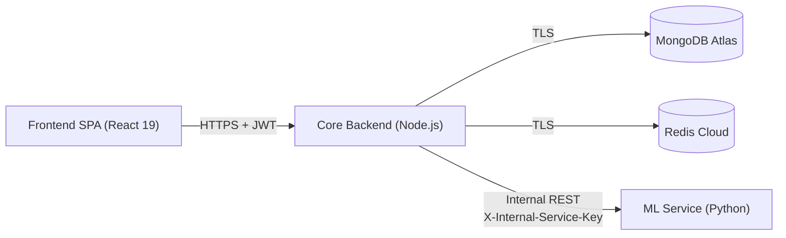

# Service Documentation: Core Backend Service (`core-backend-service`)

> **Directory**: [`backend/`](../../backend)  
> **Type**: Orchestrator, API Gateway & Business Logic Tier  
> **Hosting Options**: AWS ECS Fargate, Google Cloud Run, Render, Railway, or Kubernetes  
> **Runtime / Stack**: Node.js 20+ (LTS), Express.js (ES Modules), MongoDB Driver, ioredis, JWT, Agora SDK  

---

## 1. Role & Architectural Responsibilities

The Core Backend Service is the system's central operational engine and secure API Gateway, implemented in **Node.js (Express)**. It isolates database connections and mediates traffic between the Frontend SPA, MongoDB, Redis, and the separately hosted Python ML Inference Service.

### Primary Functions:
1. **API Gateway & Routing**:
   - Single HTTPS entry point for all frontend client traffic.
   - Request-level correlation ID (`X-Request-Id`) injection and distributed timing headers.
   - Global CORS enforcement and security headers via `helmet`.
2. **Authentication & Authorization (Per Vibe Rules Phase 3)**:
   - User registration, password hashing (`bcryptjs`), and secure JWT token lifecycle (access tokens + refresh rotation).
   - Role-Based Access Control (`patient`, `practitioner`, `admin`) enforced via Express route middleware.
3. **Clinical Assessment & Profiling Engine**:
   - Ingests raw answers from Prakriti, Vikriti, and Agni quizzes.
   - Computes weighted Dosha percentage distributions and classifies Agni state (Sama, Vishama, Tikshna, Manda).
   - Persists verified profiles and scores directly into MongoDB Atlas.
4. **Async Job Orchestration**:
   - Coordinates diet plan synthesis requests. Creates an async job record in Redis, dispatches execution to the Python ML Inference Service, and returns a `jobId` for client polling.
5. **Telehealth Token Authority**:
   - Generates dynamic, time-limited Agora RTC channel tokens using `agora-access-token` so client credentials are never exposed to the public.

---

## 2. Directory & Module Organization

```
backend/
├── package.json                # Node.js dependencies (express, mongodb, ioredis, helmet, etc.)
├── Dockerfile                  # Production container definition (node:20-alpine)
├── .dockerignore               # Container ignore rules
├── .env.example                # Environment variables template
└── src/
    ├── server.js               # Express application entry, middleware, & route mounting
    ├── config/
    │   └── index.js            # Centralized environment configuration
    ├── middleware/
    │   ├── correlation.js      # Injects X-Request-Id and tracks process duration
    │   ├── errorHandler.js     # Standardized JSON error response handler (Vibe Rules format)
    │   └── auth.js             # JWT verification and RBAC middleware
    ├── routes/
    │   ├── auth.js             # /api/v1/auth (signup, login, me, refresh)
    │   ├── assessments.js      # /api/v1/assessments (save, history)
    │   ├── dietJobs.js         # /api/v1/diet-jobs (start, poll status)
    │   ├── dietLogs.js         # /api/v1/diet-logs (meal adherence logging)
    │   └── telehealth.js       # /api/v1/telehealth/token (Agora RTC tokens)
    └── services/
        ├── mongoClient.js      # MongoDB Atlas connection pool
        ├── redisClient.js      # Redis connection for job queue & cohort cache
        └── mlClient.js         # Axios client communicating with Python ML Service
```

---

## 3. Standardized API Endpoints

| Endpoint | Method | Access | Description |
| :--- | :---: | :---: | :--- |
| `GET /health` | `GET` | Public | Lightweight container liveness probe (`status: ok`, runtime). |
| `GET /ready` | `GET` | Public | Readiness probe (verifies MongoDB & Redis pool connectivity). |
| `GET /api/v1/status` | `GET` | Public | Base API gateway operational check. |
| `POST /api/v1/auth/signup` | `POST` | Public | Register new user account. |
| `POST /api/v1/auth/login` | `POST` | Public | Authenticate user & issue JWT tokens. |
| `GET /api/v1/auth/me` | `GET` | Authenticated | Return profile of currently signed-in user. |
| `POST /api/v1/assessments` | `POST` | Authenticated | Record Prakriti / Vikriti / Agni scores into MongoDB. |
| `GET /api/v1/assessments/latest`| `GET` | Authenticated | Retrieve latest assessment history. |
| `POST /api/v1/diet-jobs/start`| `POST` | Authenticated | Create diet plan job in Redis and dispatch to ML Service. |
| `GET /api/v1/diet-jobs/:id` | `GET` | Authenticated | Poll job status (`PENDING`, `COMPLETED`, `FAILED`). |
| `POST /api/v1/diet-logs` | `POST` | Authenticated | Store patient daily meal adherence rating. |
| `POST /api/v1/telehealth/token`| `POST` | Authenticated | Issue time-limited Agora RTC channel token. |

---

## 4. Inter-Service Communication Flow



1. **Frontend to Core Backend**: Authenticated via standard `Authorization: Bearer <JWT>` header.
2. **Core Backend to ML Inference Service**: Authenticated via an internal secret token in the `X-Internal-Service-Key` header over a private VPC or internal network.
3. **Core Backend to MongoDB**: Connection pooling via the official `mongodb` Node.js driver.
4. **Core Backend to Redis**: High-throughput in-memory caching and job tracking via `ioredis`.

---

## 5. Environment Variables (`backend/.env`)

```ini
PORT=8000
ENVIRONMENT=production
ALLOWED_ORIGINS=https://ayurvarta.com,https://staging.ayurvarta.com

# Authentication
JWT_SECRET=super_secret_signing_key_min_32_chars
ACCESS_TOKEN_EXPIRE_MINUTES=30
REFRESH_TOKEN_EXPIRE_DAYS=7

# Persistence Layer
MONGODB_URI=mongodb+srv://app_user:<password>@cluster.mongodb.net/ayurvarta?retryWrites=true&w=majority
REDIS_URL=rediss://default:<password>@redis-host:6379

# Inter-Service Connection to ML Service
ML_SERVICE_URL=https://ml-inference.internal.ayurvarta.com
INTERNAL_SERVICE_KEY=internal_pre_shared_secret_token

# Agora Tele-Consultation
AGORA_APP_ID=your_agora_app_id
AGORA_APP_CERTIFICATE=your_agora_app_certificate
```

---

## 6. How to Run Locally

```bash
cd backend
npm install
npm run dev     # Starts server with automatic hot-reloading on http://localhost:8000
```
