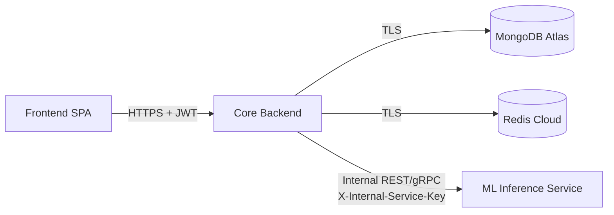

# Service Documentation: Core Backend Service (`core-backend-service`)

> **Directory**: `backend/` (or repository `babayogi`)  
> **Type**: Orchestrator, API Gateway & Business Logic Tier  
> **Hosting Options**: AWS ECS Fargate, Google Cloud Run, Render, Railway, or Kubernetes  
> **Runtime / Stack**: Python 3.11+, FastAPI, Uvicorn, Pydantic v2, Motor/PyMongo, Redis-py  

---

## 1. Role & Architectural Responsibilities

The Core Backend Service serves as the system's central nerve center and secure API Gateway. It isolates sensitive database connections and coordinates requests between the Frontend SPA, MongoDB, Redis, and the separately hosted ML Inference Service.

### Primary Functions:
1. **API Gateway & Routing**:
   - Single HTTPS entry point for all frontend client traffic.
   - Request-level correlation ID (`X-Request-Id`) injection and distributed logging.
   - Global CORS enforcement and rate limiting per IP / user.
2. **Authentication & Authorization (Per Vibe Rules Phase 3)**:
   - User registration, password hashing (via `bcrypt`), and secure JWT token lifecycle (access tokens + refresh rotation).
   - OAuth integration (Google Sign-In).
   - Role-Based Access Control (`patient`, `practitioner`, `admin`) enforced at the route level via FastAPI dependencies.
3. **Clinical Assessment Engine**:
   - Ingests raw answers from Prakriti, Vikriti, and Agni quizzes.
   - Computes weighted Dosha percentage distributions and classifies Agni state (Sama, Vishama, Tikshna, Manda).
   - Validates inputs against Pydantic schemas before persisting to MongoDB.
4. **Ayurvedic Knowledge Ontology Engine**:
   - Bundles verified classical Ayurvedic rules in structured JSON formats (`dosha_rules.json`, `viruddha_rules.json`, `ritu_charya.json`).
   - Resolves pacifying and aggravating tastes (*Shad-Rasa*) and qualities (*Vimshati Guna*) for any given Doshic combination.
   - Resolves the current Ayurvedic season (*Ritu*) based on month/geography.
5. **Async Job Orchestrator**:
   - Coordinates diet plan synthesis requests. Instead of holding long-lived HTTP connections while the LLM generates meal charts, it creates an async job record in Redis, dispatches work to the ML Inference Service, and returns a `jobId`.
6. **Telehealth Token Authority**:
   - Generates dynamic, time-limited Agora RTC channel tokens using the Agora App Certificate so client credentials are never exposed on the web.

---

## 2. Directory & Module Organization

```
backend/
├── main.py                     # FastAPI application setup, middleware, and route mounting
├── config.py                   # Pydantic Settings reading environment variables
├── requirements.txt            # Python dependencies (fastapi, uvicorn, pydantic, motor, redis)
├── routes/
│   ├── auth.py                 # /auth/signup, /auth/login, /auth/me, /auth/refresh
│   ├── assessments.py          # /assessments (POST save, GET latest)
│   ├── diet_jobs.py            # /diet-jobs/start, /diet-jobs/:id, /diet-jobs/latest
│   ├── diet_logs.py            # /diet-logs (CRUD for meal adherence)
│   └── telehealth.py           # /telehealth/token (Agora RTC token generation)
├── ontology/
│   ├── dosha_rules.json        # Classical Dosha, Rasa, Guna, and Agni matrix
│   ├── viruddha_rules.json     # Charaka's 18 food incompatibility rules & food aliases
│   ├── ritu_charya.json        # 6 seasonal cycles and dietary adaptations
│   ├── schema.py               # Pydantic v2 validators guaranteeing ontology integrity
│   ├── loader.py               # In-memory indexed query engine for fast ontology lookups
│   └── verify.py               # CLI test suite for automated ontology validation
├── services/
│   ├── ml_client.py            # Internal gRPC/REST client communicating with ML Inference Service
│   ├── redis_broker.py         # Job state tracker and cohort cache manager
│   └── mongo_service.py        # Database operations on MongoDB collections
└── middleware/
    ├── correlation.py          # Injects X-Request-Id into request context and response headers
    └── rate_limiter.py         # Leaky-bucket rate limiter backed by Redis
```

---

## 3. Standardized API Endpoints

| Endpoint | Method | Access | Description |
| :--- | :---: | :---: | :--- |
| `GET /health` | `GET` | Public | Lightweight container liveness probe. |
| `GET /ready` | `GET` | Public | Readiness probe (verifies MongoDB & Redis connections). |
| `POST /api/v1/auth/signup` | `POST` | Public | Register new user account. |
| `POST /api/v1/auth/login` | `POST` | Public | Authenticate user & issue JWT tokens. |
| `GET /api/v1/auth/me` | `GET` | Authenticated | Return profile of currently signed-in user. |
| `POST /api/v1/assessments` | `POST` | Authenticated | Record Prakriti / Vikriti / Agni scores into MongoDB. |
| `GET /api/v1/assessments/latest`| `GET` | Authenticated | Retrieve latest assessment history. |
| `POST /api/v1/diet-jobs/start`| `POST` | Authenticated | Create diet plan job in Redis and dispatch to ML Service. |
| `GET /api/v1/diet-jobs/{id}` | `GET` | Authenticated | Poll job status (`PENDING`, `COMPLETED`, `FAILED`). |
| `POST /api/v1/diet-logs` | `POST` | Authenticated | Store patient daily meal adherence rating. |
| `POST /api/v1/telehealth/token`| `POST` | Authenticated | Issue time-limited Agora RTC channel token. |

---

## 4. Inter-Service Communication



1. **Frontend to Core Backend**: Authenticated via standard `Authorization: Bearer <JWT>` header.
2. **Core Backend to ML Inference Service**: Authenticated via an internal secret token in the `X-Internal-Service-Key` header over a private VPC or mTLS network.
3. **Core Backend to MongoDB**: Connection pooling managed by Motor (async PyMongo driver) over encrypted connection string.
4. **Core Backend to Redis**: Connection pool for atomic job state updates and distributed rate limiting.

---

## 5. Environment Variables (`backend/.env`)

```ini
# Server Settings
PORT=8000
ENVIRONMENT=production
ALLOWED_ORIGINS=https://ayurvarta.com,https://staging.ayurvarta.com

# Authentication
JWT_SECRET=super_secret_signing_key_min_32_chars
JWT_ALGORITHM=HS256
ACCESS_TOKEN_EXPIRE_MINUTES=30
REFRESH_TOKEN_EXPIRE_DAYS=7

# Persistence Layer
MONGODB_URI=mongodb+srv://app_user:<password>@cluster.mongodb.net/ayurvarta?retryWrites=true&w=majority
REDIS_URL=rediss://default:<password>@redis-host:6379

# Inter-Service Connection to ML Service
ML_SERVICE_URL=https://ml-inference.internal.ayurvarta.com
INTERNAL_SERVICE_KEY=internal_pre_shared_secret_token

# Agora Tele-Consultation
AGORA_APP_ID=your_agora_app_id
AGORA_APP_CERTIFICATE=your_agora_app_certificate
```

---

## 6. How to Run Locally

```bash
cd backend
python -m venv venv
# On Windows:
.\venv\Scripts\activate
# On Linux/macOS:
source venv/bin/activate

pip install -r requirements.txt
python -m ontology.verify        # Verify Ayurvedic ontology rules & schemas
uvicorn main:app --reload --port 8000
```
