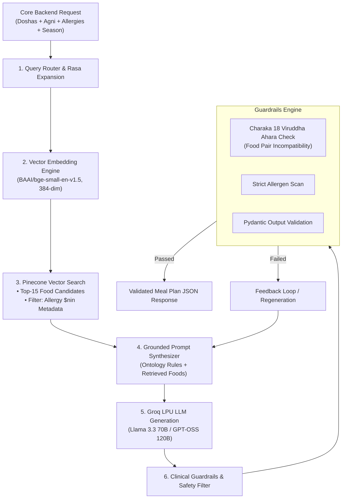

# Service Documentation: ML Inference & RAG Service (`ml-inference-service`)

> **Directory**: [`ml-service/`](../../ml-service)  
> **Type**: Dedicated Machine Learning, Vector Retrieval & Clinical AI Tier  
> **Hosting Options**: RunPod, Modal, AWS SageMaker, Dedicated GPU Compute  
> **Runtime / Stack**: Python 3.11+, FastAPI, Pinecone Client, Groq SDK (`groq`), FastEmbed (`BAAI/bge-small-en-v1.5`), Pydantic v2  

---

## 1. Role & Architectural Responsibilities

The ML Inference Service is an isolated, compute-intensive service responsible for semantic vector retrieval, ultra-fast **Groq LPU** Large Language Model orchestration, and clinical safety verification.

By hosting this service separately from the Node.js Core Backend:
1. Long-running RAG synthesis and embedding computations never block Node.js event-loop authentication or CRUD traffic.
2. Embedding models (`BAAI/bge-small-en-v1.5` ONNX/FastEmbed) can run on dedicated compute nodes with custom memory and CPU/GPU allocations.
3. Proprietary RAG prompt chains, Groq inference orchestration, and Ayurvedic clinical guardrails remain strictly encapsulated.

---

## 2. Core Subsystems

```text
ml-service/
├── app.py                      # FastAPI microservice wrapper with internal API endpoints
├── config.py                   # Model endpoints, Groq & Pinecone configs, temperature settings
├── Dockerfile                  # Python 3.11 container definition
├── requirements.txt            # FastAPI, Groq SDK, Pinecone, FastEmbed
├── .env.example                # Environment variables template
├── pipeline/                   # (Planned Modular Pipeline)
│   ├── query_router.py         # Routes and expands queries with Shad-Rasa & Guna weights
│   ├── embedder.py             # Generates 384-dim vectors (BAAI/bge-small-en-v1.5)
│   ├── vector_retriever.py     # Executes top-K vector search with Pinecone metadata filtering
│   ├── generator.py            # Executes Groq LLM inference (Llama 3.3 70B / GPT-OSS 120B)
│   └── guardrails.py           # Viruddha Ahara 18-rule scanner & CRAG hallucination verifier
└── schemas/
    ├── request.py              # Pydantic schema for inbound diet generation requests
    └── diet_output.py          # Strict Pydantic schema for structured clinical meal outputs
```

---

## 3. Detailed Processing Pipeline



### Step 1: Semantic Query Expansion
Before searching the vector database, the service enriches the query using Ayurvedic Knowledge Ontology weights:
- For a **Vata-aggravated** profile, the query is expanded with pacifying tastes (*Madhura*, *Amla*, *Lavana*) and qualities (*Snigdha*, *Guru*, *Ushna*).
- Contraindicated items (*Katu*, *Tikta*, *Kashaya*, *Ruksha*) are deprioritized or excluded.

### Step 2: Vector Database Retrieval
- Embeds the expanded query using `BAAI/bge-small-en-v1.5` (384 dimensions) via FastEmbed.
- Searches the Pinecone `ayurvedic-foods-v2` index (or local Qdrant in dev) with metadata filters:
  ```json
  {
    "allergy_tags": { "$nin": ["gluten", "peanuts", "dairy"] },
    "seasonal_suitability": { "$in": ["varsha", "all_seasons"] }
  }
  ```
- Retrieves top 15 candidate Ayurvedic food items with their classical Rasa, Guna, Virya, and Vipaka properties.

### Step 3: Groq LPU LLM Generation
- Formulates a system prompt grounded strictly in the retrieved foods and classical principles.
- Executes against **Groq** (`llama-3.3-70b-versatile` primary, `openai/gpt-oss-120b` fallback) for ultra-low-latency structured JSON generation.
- Enforces JSON schema compliance conforming to the `DietPlanOutput` contract.

### Step 4: Clinical Guardrails (*Viruddha Ahara* & CRAG)
- Evaluates generated meals against the 18 Charaka incompatibility rules:
  - *Samyoga Viruddha* (adverse combinations: e.g., milk + fish, milk + sour fruit).
  - *Samskara Viruddha* (adverse processing: e.g., heated honey).
  - *Kala Viruddha* (time/season mismatch: e.g., curd at night).
- If an incompatibility is discovered, the guardrail rejects the draft and triggers automatic regeneration or attaches clinical warning annotations.

---

## 4. Internal API Contracts

This service is internal only. It requires the `X-Internal-Service-Key` header on all requests.

### Endpoint: `POST /internal/v1/rag/generate-diet`
#### Inbound Request Body:
```json
{
  "requestId": "req_8f12a84c",
  "prakriti": { "Vata": 60, "Pitta": 25, "Kapha": 15 },
  "vikriti": { "Vata": 70, "Pitta": 20, "Kapha": 10 },
  "agni": "Vishama",
  "season": "Hemanta",
  "allergies": ["peanuts", "shellfish"],
  "dietaryRestrictions": ["vegetarian"],
  "healthGoals": ["reduce anxiety", "improve joint lubrication"]
}
```

#### Outbound Validated Response:
```json
{
  "success": true,
  "data": {
    "summary": "Vata-pacifying winter nourishment plan...",
    "doshaProfile": { "dominant": "Vata", "secondary": "Pitta", "agni": "Vishama" },
    "dailyMealPlan": {
      "meals": [
        {
          "name": "Breakfast",
          "time": "08:00 AM",
          "items": ["Warm Spiced Oats with Almond Milk and Dates"],
          "rasas": ["Madhura"],
          "gunas": ["Snigdha", "Guru", "Ushna"],
          "ayurvedicRationale": "Nourishes Rasa Dhatu and grounds Vata."
        }
      ]
    },
    "viruddhaSafetyChecks": [
      { "status": "PASSED", "rule": "No heated honey detected", "severity": "NONE" },
      { "status": "PASSED", "rule": "No incompatible dairy pairings detected", "severity": "NONE" }
    ]
  },
  "meta": {
    "requestId": "req_8f12a84c",
    "model": "llama-3.3-70b-versatile",
    "guardrailsPassed": true,
    "latencyMs": 640
  }
}
```

---

## 5. Environment Variables (`ml-service/.env`)

```ini
PORT=8001
ENVIRONMENT=production
INTERNAL_SERVICE_KEY=internal_pre_shared_secret_token

# Vector Database (Pinecone)
PINECONE_API_KEY=your_pinecone_api_key
PINECONE_ENVIRONMENT=us-east-1
PINECONE_INDEX_NAME=ayurvedic-foods-v2

# Groq AI Inference
GROQ_API_KEY=your_groq_api_key

# Model Configurations
EMBEDDING_MODEL=BAAI/bge-small-en-v1.5
EMBEDDING_DIMENSIONS=384
PRIMARY_LLM=llama-3.3-70b-versatile
FALLBACK_LLM=openai/gpt-oss-120b
LLM_TEMPERATURE=0.2
```

---

## 6. How to Run Locally

```bash
cd ml-service
python -m venv venv
# Windows: .\venv\Scripts\activate | Unix: source venv/bin/activate
pip install -r requirements.txt
uvicorn app:app --reload --port 8001
```
