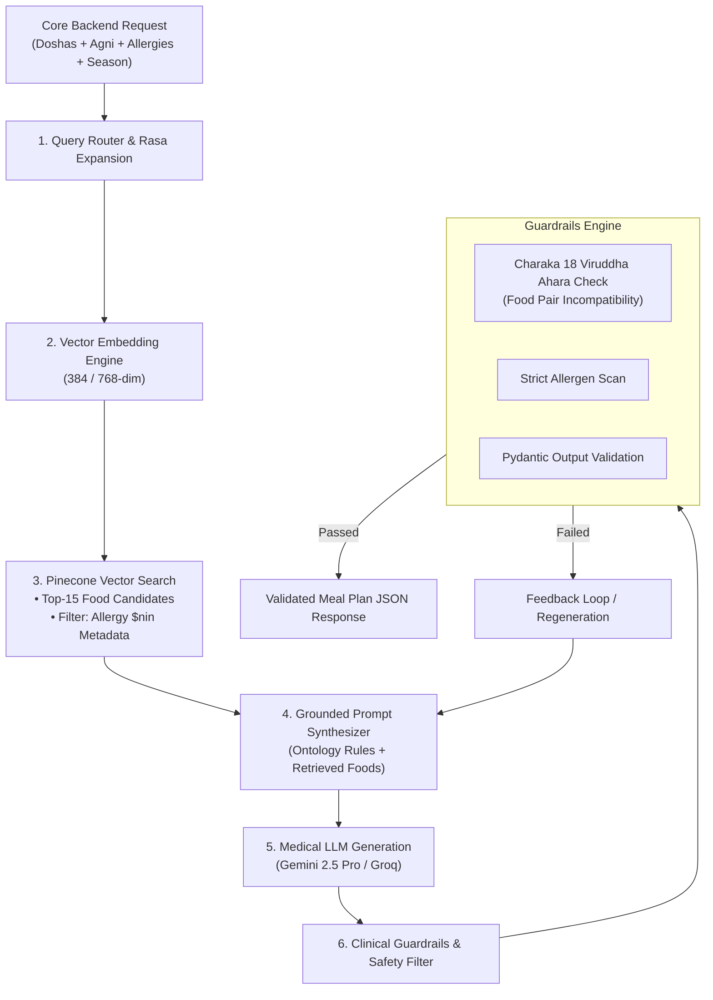

# Service Documentation: ML Inference & RAG Service (`ml-inference-service`)

> **Directory**: `ml-service/` (or repository `ayurvarta-ml`)  
> **Type**: Dedicated Machine Learning, Vector Retrieval & Clinical AI Tier  
> **Hosting Options**: AWS SageMaker, RunPod, Modal, GCP Vertex AI, or Dedicated GPU Compute  
> **Runtime / Stack**: Python 3.11+, FastAPI, Pinecone Client, Google GenAI SDK (`@google/genai`), Groq SDK, Pydantic v2  

---

## 1. Role & Architectural Responsibilities

The ML Inference Service is an isolated, compute-intensive service responsible for semantic vector retrieval, Large Language Model orchestration, and clinical safety verification.

By hosting this service separately from the Core Backend:
1. Long-running LLM generation threads never exhaust or block standard user authentication or CRUD database connections.
2. The service can be deployed on specialized compute nodes (GPU-accelerated instances or serverless ML runtimes) with custom memory and timeout configurations.
3. Proprietary RAG prompt chains, embedding logic, and Ayurvedic clinical guardrails remain strictly encapsulated.

---

## 2. Core Subsystems

```
ml-service/
├── app.py                      # FastAPI microservice wrapper with internal API endpoints
├── config.py                   # Model endpoints, Pinecone configs, temperature settings
├── pipeline/
│   ├── query_router.py         # Routes and expands queries with Shad-Rasa & Guna weights
│   ├── embedder.py             # Generates dense vectors (Gemini-embedding-001 or Bio-Embeddings)
│   ├── vector_retriever.py     # Executes top-K vector search with Pinecone metadata filtering
│   ├── generator.py            # Executes LLM inference (Gemini 2.5 Pro / Groq Llama-3.3-70B)
│   └── guardrails.py           # Viruddha Ahara 18-rule scanner & CRAG hallucination verifier
└── schemas/
    ├── request.py              # Pydantic schema for inbound diet generation requests
    └── diet_output.py          # Strict Pydantic schema for structured clinical meal outputs
```

---

## 3. Detailed Processing Pipeline



### Step 1: Semantic Query Expansion
Before searching the vector database, the service queries the Ayurvedic Knowledge Ontology:
- For a **Vata-aggravated** profile, the query is expanded with pacifying tastes (*Madhura*, *Amla*, *Lavana*) and qualities (*Snigdha*, *Guru*, *Ushna*).
- Contraindicated items (*Katu*, *Tikta*, *Kashaya*, *Ruksha*) are assigned negative weights.

### Step 2: Vector Database Retrieval
- Searches the Pinecone `ayurvedic-foods-v2` index using the computed semantic vector.
- Injects metadata filters:
  ```json
  {
    "allergy_tags": { "$nin": ["gluten", "peanuts", "dairy"] },
    "seasonal_suitability": { "$in": ["varsha", "all_seasons"] }
  }
  ```
- Retrieves top 15 candidate Ayurvedic food items with their classical Rasa, Guna, Virya, and Vipaka properties.

### Step 3: LLM Generation
- Formulates a system prompt grounded in the retrieved foods and classical principles.
- Executes against **Google Gemini 2.5 Pro** (or Groq Llama-3.3-70B for low-latency inference).
- Requests strict JSON conforming to the `DietPlanOutput` schema.

### Step 4: Clinical Guardrails (*Viruddha Ahara* & CRAG)
- Evaluates the generated meals against the 18 Charaka incompatibility rules:
  - *Samyoga Viruddha* (adverse combinations: e.g. milk + fish, milk + sour fruit).
  - *Samskara Viruddha* (adverse processing: e.g. heated honey).
  - *Kala Viruddha* (time/season mismatch: e.g. curd at night).
- If an incompatibility is discovered, the guardrail rejects the draft and triggers an automatic prompt regeneration or attaches warning annotations.

---

## 4. Internal API Contracts

This service is internal only. It requires the `X-Internal-Service-Key` header on all requests.

### Endpoint: `POST /internal/v1/rag/generate-diet`
#### Inbound Request Body:
```json
{
  "requestId": "req_8f12a84c",
  "prakriti": { "Vata": 60, "Pitta": 25, "Kapha": 15 },
  "vikriti": { "Vata": 70, "Pitta": 20, "Kapha": 10 },
  "agni": "Vishama",
  "season": "Hemanta",
  "allergies": ["peanuts", "shellfish"],
  "dietaryRestrictions": ["vegetarian"],
  "healthGoals": ["reduce anxiety", "improve joint lubrication"]
}
```

#### Outbound Validated Response:
```json
{
  "success": true,
  "data": {
    "summary": "Vata-pacifying winter nourishment plan...",
    "doshaProfile": { "dominant": "Vata", "secondary": "Pitta", "agni": "Vishama" },
    "dailyMealPlan": {
      "meals": [
        {
          "name": "Breakfast",
          "time": "08:00 AM",
          "items": ["Warm Spiced Oats with Almond Milk and Dates"],
          "rasas": ["Madhura"],
          "gunas": ["Snigdha", "Guru", "Ushna"],
          "ayurvedicRationale": "Nourishes Rasa Dhatu and grounds Vata."
        }
      ]
    },
    "viruddhaSafetyChecks": [
      { "status": "PASSED", "rule": "No heated honey detected", "severity": "NONE" },
      { "status": "PASSED", "rule": "No incompatible dairy pairings detected", "severity": "NONE" }
    ]
  },
  "meta": {
    "model": "gemini-2.5-pro",
    "retrievedFoodCandidates": 15,
    "guardrailsPassed": true,
    "latencyMs": 4210
  }
}
```

---

## 5. Environment Variables (`ml-service/.env`)

```ini
PORT=8001
ENVIRONMENT=production
INTERNAL_SERVICE_KEY=internal_pre_shared_secret_token

# Vector Database (Pinecone)
PINECONE_API_KEY=your_pinecone_api_key
PINECONE_ENVIRONMENT=us-east-1
PINECONE_INDEX_NAME=ayurvedic-foods-v2

# Large Language Models
GEMINI_API_KEY=your_google_gemini_api_key
GROQ_API_KEY=your_groq_api_key

# Model Configurations
EMBEDDING_MODEL=gemini-embedding-001
EMBEDDING_DIMENSIONS=384
PRIMARY_LLM=gemini-2.5-pro
FALLBACK_LLM=groq-llama-3.3-70b-versatile
LLM_TEMPERATURE=0.2
```

---

## 6. How to Run Locally

```bash
cd ml-service
python -m venv venv
source venv/bin/activate    # Or .\venv\Scripts\activate on Windows
pip install -r requirements.txt
uvicorn app:app --reload --port 8001
```
