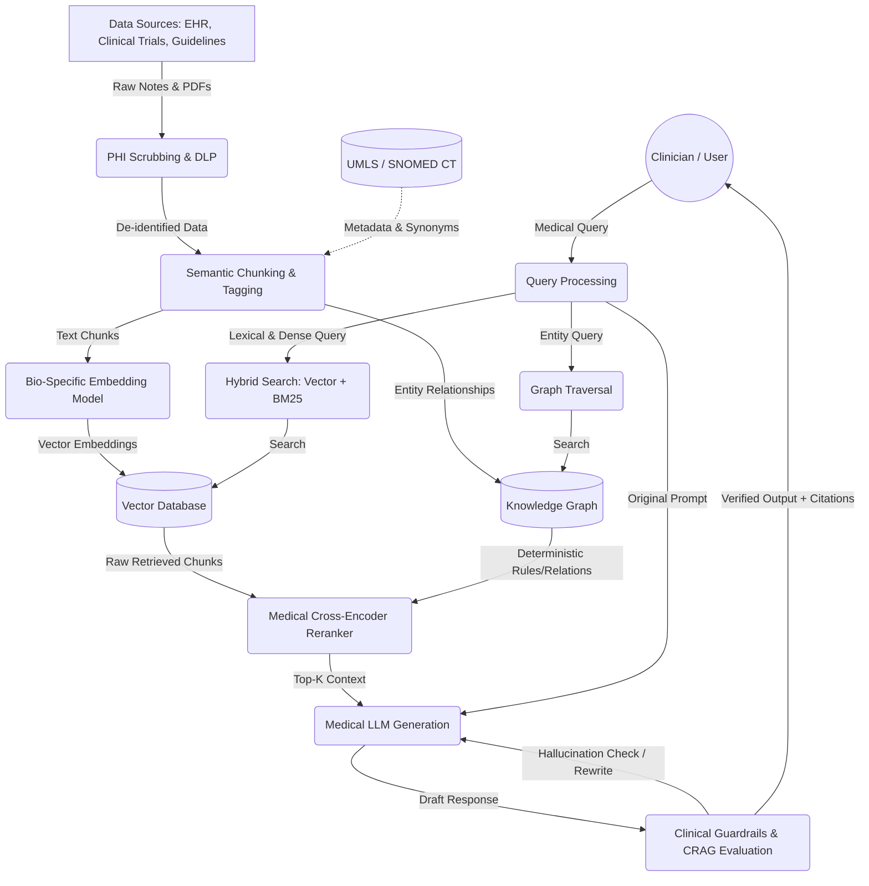
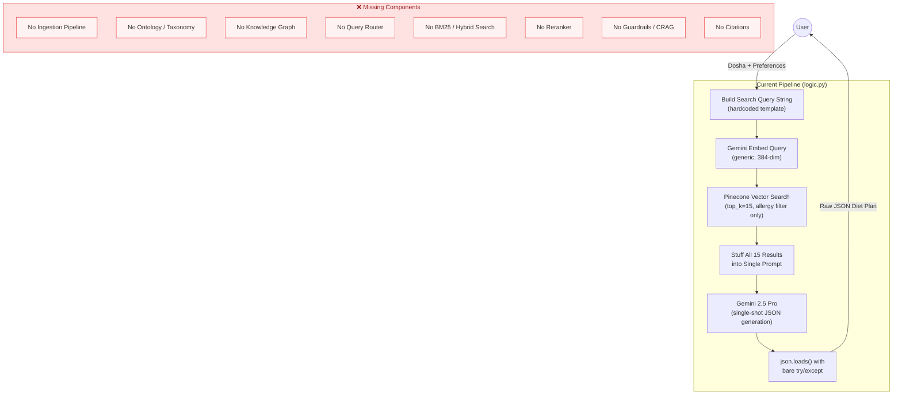
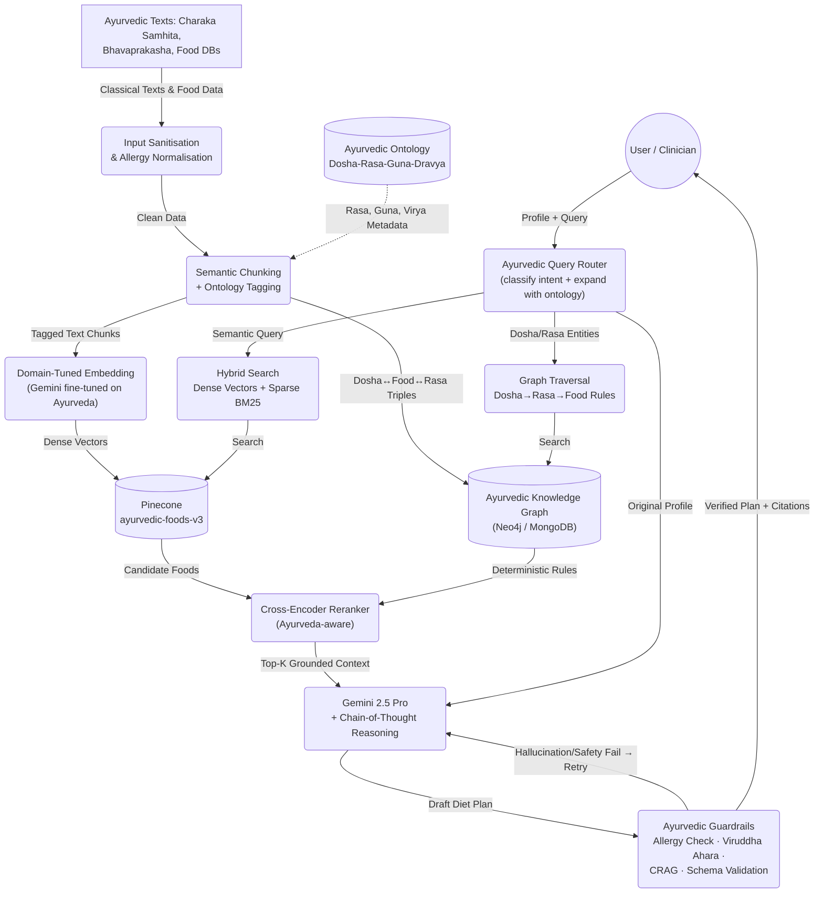

# AyurVarta RAG Pipeline — Gap Analysis vs. Reference Architecture

## Reference Architecture (Your Diagram)



---

## Side-by-Side Comparison

The table below maps **every node in the reference diagram** to what AyurVarta actually implements today, with a severity rating for each gap.

| # | Diagram Node | What AyurVarta Has | Gap Severity | Code Location |
|---|---|---|---|---|
| 1 | **Data Sources** (EHR, Trials, Guidelines) | Pre-populated Pinecone index `ayurvedic-foods-v2` — no visible ingestion pipeline, no Ayurvedic text corpus (Charaka Samhita, Ashtanga Hridayam, etc.) | 🔴 Critical | No ingestion code exists |
| 2 | **PHI Scrubbing & DLP** | None. User assessment scores flow directly into the pipeline | 🟡 Medium | N/A — diet profiles aren't clinical PHI, but allergy/health data should still be handled carefully |
| 3 | **Semantic Chunking & Tagging** | None. Food items appear to be pre-chunked as individual records in Pinecone (one vector per dish) | 🔴 Critical | No chunking code — [`logic.py`](file:///S:/Workplace/AyurVarta-SIH_2025/backend/babayogi/logic.py) only queries, never ingests |
| 4 | **Ontology (UMLS / SNOMED CT)** | **Completely absent.** No Ayurvedic ontology mapping (no Rasa ↔ Taste, no Guna ↔ Quality, no Dosha ↔ Food Property taxonomy) | 🔴 Critical | No ontology files or code |
| 5 | **Knowledge Graph** | **Completely absent.** No graph database, no entity relationships between Doshas → Rasas → Foods → Seasons → Agni types | 🔴 Critical | No graph DB connection |
| 6 | **Bio-Specific Embedding** | Uses generic `gemini-embedding-001` at 384 dimensions. Not fine-tuned on Ayurvedic or biomedical terminology | 🟠 High | [`logic.py` L31, L63-68](file:///S:/Workplace/AyurVarta-SIH_2025/backend/babayogi/logic.py#L31) |
| 7 | **Vector Database** | ✅ Pinecone `ayurvedic-foods-v2` — present and working | ✅ Present | [`logic.py` L36](file:///S:/Workplace/AyurVarta-SIH_2025/backend/babayogi/logic.py#L36) |
| 8 | **Query Router** | **Absent.** Single hardcoded query template, no intent classification, no routing between lexical/semantic/graph paths | 🔴 Critical | [`logic.py` L54-60](file:///S:/Workplace/AyurVarta-SIH_2025/backend/babayogi/logic.py#L54-L60) |
| 9 | **Hybrid Search (Vector + BM25)** | **Vector-only.** No BM25/lexical search component. Only metadata `$nin` filtering for allergies | 🟠 High | [`logic.py` L76-81](file:///S:/Workplace/AyurVarta-SIH_2025/backend/babayogi/logic.py#L76-L81) |
| 10 | **Graph Traversal** | **Absent** (no KG exists) | 🔴 Critical | — |
| 11 | **Cross-Encoder Reranker** | **Absent.** Raw Pinecone results (top-15) go straight into the prompt with zero reranking | 🟠 High | [`logic.py` L82](file:///S:/Workplace/AyurVarta-SIH_2025/backend/babayogi/logic.py#L82) |
| 12 | **Medical LLM Generation** | Gemini 2.5 Pro with a single-shot structured prompt. No multi-turn reasoning, no chain-of-thought | 🟡 Medium | [`logic.py` L89-99](file:///S:/Workplace/AyurVarta-SIH_2025/backend/babayogi/logic.py#L89-L99) |
| 13 | **Clinical Guardrails & CRAG** | **Completely absent.** No hallucination detection, no output validation against source facts, no citation linking, no contraindication checking | 🔴 Critical | [`logic.py` L94-99](file:///S:/Workplace/AyurVarta-SIH_2025/backend/babayogi/logic.py#L94-L99) — bare `json.loads` with catch-all |
| 14 | **Verified Output + Citations** | **No citations.** Response JSON has no provenance field linking recommendations back to source texts or retrieved food records | 🔴 Critical | The prompt in [`logic.py` L121-156](file:///S:/Workplace/AyurVarta-SIH_2025/backend/babayogi/logic.py#L121-L156) never asks for citations |

---

## Current AyurVarta Pipeline (Actual Flow)



---

## Prioritised Improvement Roadmap

### 🔴 Phase 1 — Foundation (Critical Gaps)

#### 1.1 Build an Ayurvedic Ontology Layer
> [!IMPORTANT]
> This is the single highest-leverage improvement. Ayurveda has a well-defined taxonomy that maps directly to a Knowledge Graph.

Replace the diagram's `UMLS / SNOMED CT` with an **Ayurvedic Ontology** containing:

| Concept | Entities | Relationships |
|---|---|---|
| **Dosha** | Vata, Pitta, Kapha | `aggravated_by` → Rasa, Guna, Season |
| **Rasa** (Taste) | Madhura, Amla, Lavana, Katu, Tikta, Kashaya | `pacifies` → Dosha, `found_in` → Food |
| **Guna** (Quality) | Laghu, Guru, Snigdha, Ruksha, Ushna, Sheeta… | `increases` → Dosha |
| **Agni** (Digestive Fire) | Vishama, Tikshna, Manda, Sama | `requires` → Food Property |
| **Ritu** (Season) | Hemanta, Shishira, Vasanta, Grishma, Varsha, Sharad | `aggravates` → Dosha |
| **Dravya** (Substance/Food) | Individual foods | `has_rasa`, `has_guna`, `has_virya`, `has_vipaka` |

**Implementation**: Store as a Neo4j or MongoDB graph collection, seed from classical texts like Charaka Samhita, Bhavaprakasha Nighantu.

#### 1.2 Build an Ingestion Pipeline
Currently, food data exists only in a pre-populated Pinecone index with no visible data pipeline. Create:

```
Ayurvedic Texts (PDFs / structured data)
  → Text Extraction
  → Semantic Chunking (by food item, by dosha rule, by seasonal guideline)
  → Ontology Tagging (attach Rasa, Guna, Dosha metadata to each chunk)
  → Dual Output:
      → Embeddings → Pinecone (enriched metadata)
      → Entity Triples → Knowledge Graph
```

#### 1.3 Add a Query Router
The current code generates a single hardcoded search query at [`logic.py` L54-60](file:///S:/Workplace/AyurVarta-SIH_2025/backend/babayogi/logic.py#L54-L60). Replace with:

```python
class QueryRouter:
    def route(self, user_payload: dict) -> list[SearchPlan]:
        """Determine which retrieval strategies to use."""
        plans = []
        # Always: vector similarity for food retrieval
        plans.append(VectorSearchPlan(query=self._build_semantic_query(user_payload)))
        # Always: graph traversal for deterministic dosha-rasa-guna rules
        plans.append(GraphSearchPlan(
            dosha=user_payload['profile']['vikriti'],
            season=user_payload['environment']['season'],
            agni=user_payload['health']['agni']
        ))
        # Conditional: BM25 for exact food name / allergy matching
        if user_payload['dietPreferences']['allergies']:
            plans.append(LexicalSearchPlan(
                terms=user_payload['dietPreferences']['allergies'],
                mode='exclusion'
            ))
        return plans
```

#### 1.4 Add Clinical Guardrails & CRAG

> [!CAUTION]
> This is the most dangerous gap. The LLM's JSON output is currently parsed with a bare `json.loads()` and returned to the user with **zero safety validation**. A hallucinated food recommendation for someone with a severe allergy could be harmful.

Implement a multi-layer verification pipeline:

| Layer | Check | Current Status |
|---|---|---|
| **Schema Validation** | Verify JSON output matches Pydantic model | ❌ Only `json.loads()` |
| **Allergy Cross-Check** | Verify no recommended foods contain declared allergens | ❌ Absent |
| **Ontology Consistency** | Verify "foods to pacify Pitta" aren't actually Pitta-aggravating per the ontology | ❌ Absent |
| **Contraindication Check** | Flag dangerous combinations (e.g., honey + ghee in equal quantities — an Ayurvedic *viruddha ahara*) | ❌ Absent |
| **CRAG Score** | Score retrieval relevance; if below threshold, re-retrieve with expanded query | ❌ Absent |
| **Citation Injection** | Each food recommendation should cite which retrieved source/text supports it | ❌ Absent |

---

### 🟠 Phase 2 — Quality & Precision (High Gaps)

#### 2.1 Hybrid Search (Vector + BM25)
Current: Pure vector search with metadata `$nin` filtering.

**Add BM25** for exact-match scenarios that vector search misses:
- Exact allergen name matching ("*Sesamum indicum*" vs "sesame")
- Exact cuisine/dish name matching for regional foods
- Exact Rasa/Guna keyword matching from ontology terms

Pinecone supports sparse-dense hybrid vectors, or you can use **Elasticsearch alongside Pinecone** and merge results before reranking.

#### 2.2 Cross-Encoder Reranker
Current: Raw Pinecone `top_k=15` results are stuffed directly into the prompt at [`logic.py` L117-118](file:///S:/Workplace/AyurVarta-SIH_2025/backend/babayogi/logic.py#L117-L118).

**Add a reranker** between retrieval and generation:
```python
from sentence_transformers import CrossEncoder

reranker = CrossEncoder('cross-encoder/ms-marco-MiniLM-L-6-v2')  # or a bio-specific one

def rerank_foods(query: str, foods: list[dict], top_k: int = 10) -> list[dict]:
    pairs = [(query, f"{f['Dish Name']} - {f.get('Category','')} - {f.get('Properties','')}") for f in foods]
    scores = reranker.predict(pairs)
    ranked = sorted(zip(scores, foods), key=lambda x: x[0], reverse=True)
    return [food for _, food in ranked[:top_k]]
```

This is especially important because Ayurvedic food suitability depends on nuanced properties (Virya, Vipaka) that cosine similarity on generic embeddings often misranks.

#### 2.3 Domain-Aware Embeddings
Current: Generic `gemini-embedding-001` knows nothing about Ayurvedic terminology.

Options:
- **Fine-tune** an embedding model on Ayurvedic corpus pairs (e.g., "Pitta-pacifying food" ↔ "cooling, bitter, astringent taste foods")
- **Prompt-augmented embedding**: Prepend ontology context to the embed query (e.g., "In Ayurveda, Pitta dosha is pacified by Madhura, Tikta, and Kashaya rasas. Find foods with these properties...")
- Use **PubMedBERT** or **BioSentVec** as a secondary embedding model for cross-referencing

---

### 🟡 Phase 3 — Polish & Advanced Features

#### 3.1 Multi-Turn / Chain-of-Thought Generation
Replace the single-shot prompt with a reasoning chain:
1. **Step 1**: Given user profile, what are the Ayurvedic dietary principles? (reasoning from ontology)
2. **Step 2**: Given retrieved foods, which align with those principles? (grounded selection)
3. **Step 3**: Compose the meal plan from validated foods only (constrained generation)

#### 3.2 Citation & Provenance
Modify the prompt schema to require citations:
```json
{
  "food_guidelines": {
    "grains": {
      "can_eat": [
        { "name": "Barley", "source": "Charaka Samhita, Sutra Sthana 27.15", "rasa": "Kashaya" }
      ]
    }
  }
}
```

#### 3.3 Feedback Loop
The existing `diet_logs` collection with `adherence` scoring ([`main.py` L678-693](file:///S:/Workplace/AyurVarta-SIH_2025/backend/babayogi/main.py#L678-L693)) is an excellent foundation. Wire it back into the pipeline:
- Low adherence scores on specific foods → de-rank those foods in future retrievals
- High adherence + positive health outcomes → boost those food vectors

#### 3.4 PHI Scrubbing (Contextualised)
While Ayurveda diet profiles aren't traditional EHR/PHI data, the system stores:
- Health conditions (Vikriti disease data)
- Allergies
- Assessment scores over time

If expanding to clinical partnerships, add a DLP layer for PII in free-text fields (e.g., chatbot conversations, medical profile notes).

---

## Proposed Target Architecture



---

## Summary Scorecard

| Component | Reference Diagram | AyurVarta Status | Priority |
|:---|:---:|:---:|:---:|
| Data Ingestion Pipeline | ✅ | ❌ Missing | 🔴 P0 |
| Ontology (Ayurvedic Taxonomy) | ✅ | ❌ Missing | 🔴 P0 |
| Knowledge Graph | ✅ | ❌ Missing | 🔴 P0 |
| Query Router | ✅ | ❌ Missing | 🔴 P0 |
| Guardrails & CRAG | ✅ | ❌ Missing | 🔴 P0 |
| Citations / Provenance | ✅ | ❌ Missing | 🔴 P0 |
| Hybrid Search (BM25) | ✅ | ❌ Vector-only | 🟠 P1 |
| Cross-Encoder Reranker | ✅ | ❌ Missing | 🟠 P1 |
| Bio/Domain Embedding | ✅ | 🟡 Generic model | 🟠 P1 |
| PHI Scrubbing / DLP | ✅ | ❌ Missing | 🟡 P2 |
| Vector Database | ✅ | ✅ Pinecone | ✅ Done |
| LLM Generation | ✅ | 🟡 Single-shot | 🟡 P2 |
| Profile Cohort Caching | — | ✅ Cosine dedup | ✅ Bonus |

**Overall alignment: ~15% of the reference architecture is implemented.** The vector database and LLM generation form a minimal viable RAG, but the ingestion layer, knowledge graph, retrieval quality stack (router → hybrid search → reranker), and safety layer (guardrails → CRAG → citations) are entirely absent.
