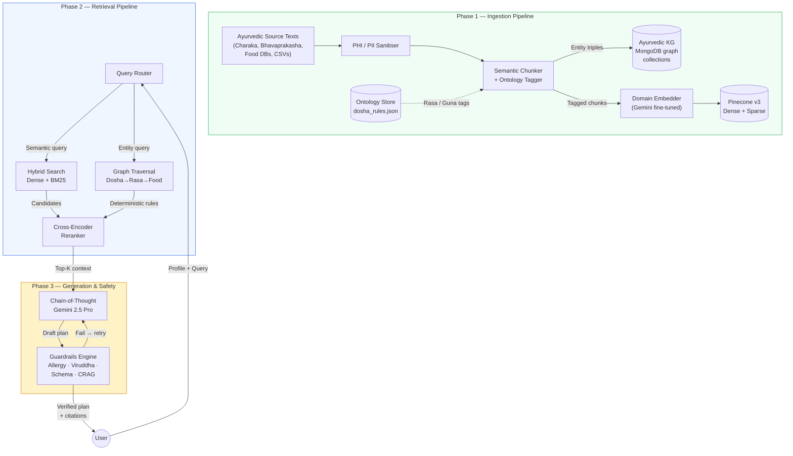
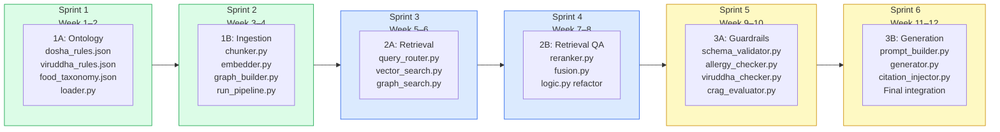

# AyurVarta RAG — Full Implementation Plan

> [!IMPORTANT]
> This plan transforms AyurVarta from a minimal "vector search → single-shot LLM" pipeline into a production-grade Ayurvedic RAG system aligned with the reference clinical architecture. It is organised into **4 phases** across **~6 sprints** (12 weeks), prioritising safety-critical gaps first.

---

## Target Architecture



---

## Overall Implementation Checklist & Status Dashboard

| Phase / Module | Focus | Status | Progress |
| :--- | :--- | :---: | :--- |
| **Quick Wins** | Frontend test & config repairs | **DONE** | 100% (App.test.js & firebase/config.js fixed) |
| **Phase 1A: Ontology** | Dosha, Rasa, Guna, Agni, Viruddha & Ritucharya | **DONE** | 100% (All 3 JSONs + Pydantic schema + loader + CLI verifier + logic.py integration) |
| **Phase 1B: Ingestion** | Semantic chunker, ontology tagger & MongoDB KG triples | **PENDING** | 0% (Food data currently queried from Pinecone `ayurvedic-foods-v2`) |
| **Phase 2: Retrieval** | Query router, hybrid dense+BM25, KG traversal & reranker | **PENDING** | 20% (Basic query expansion added to logic.py) |
| **Phase 3: Guardrails** | Schema validation, allergy checker, CRAG & citations | **IN PROGRESS**| 25% (Viruddha Ahara post-check added to logic.py) |
| **Phase 4: Feedback & Observability** | Adherence feedback loop & fine-tuning | **PENDING** | 0% |

---

## Current File Map & Module Status

```
backend/babayogi/
├── main.py                     ← Existing. Routes & auth (keep, extend)
├── logic.py                    ← Existing. [UPDATED] Ontology-aware retrieval & Viruddha safety check
├── requirements.txt            ← Existing. Extend
├── .env / .env.example         ← Existing. Add new keys
│
├── ontology/                   ← [COMPLETED - Phase 1A]
│   ├── __init__.py             ← Exports AyurvedicOntology query class
│   ├── dosha_rules.json        ← 32 KB — Tridosha, Shad-Rasa, Vimshati Guna, Agni, Dhatus, Dual Prakriti
│   ├── viruddha_rules.json     ← 20 KB — 18 categories, 20 specific food rules with citations & aliases
│   ├── ritu_charya.json        ← 17 KB — 6 Ritus, seasonal dosha states & dietary regimens
│   ├── schema.py               ← Pydantic v2 schemas validating every concept
│   ├── loader.py               ← Runtime query engine & context builder
│   ├── verify.py               ← Standalone CLI verifier: python -m ontology.verify (100% pass)
│   └── foods/
│       └── __init__.py         ← Food architecture note (data resides in Pinecone)
│
├── ingestion/                  ← [PENDING - Phase 1B]
│   ├── __init__.py
│   ├── chunker.py              ← Semantic chunking with ontology tagging
│   ├── embedder.py             ← Domain embedding + Pinecone upsert
│   ├── graph_builder.py        ← Extract entity triples → MongoDB
│   └── run_pipeline.py         ← CLI entrypoint: python -m ingestion.run_pipeline
│
├── retrieval/                  ← [PENDING - Phase 2]
│   ├── __init__.py
│   ├── query_router.py         ← Intent classification & multi-path routing
│   ├── vector_search.py        ← Dense + sparse hybrid Pinecone query
│   ├── graph_search.py         ← MongoDB graph traversal for dosha rules
│   ├── reranker.py             ← Cross-encoder reranking
│   └── fusion.py               ← Reciprocal Rank Fusion of all sources
│
├── guardrails/                 ← [PENDING - Phase 3]
│   ├── __init__.py
│   ├── schema_validator.py     ← Pydantic model for LLM output
│   ├── allergy_checker.py      ← Cross-check output vs declared allergens
│   ├── viruddha_checker.py     ← Incompatible food combination detection
│   ├── crag_evaluator.py       ← Corrective RAG: score & re-retrieve
│   ├── citation_injector.py    ← Link each recommendation to source chunk
│   └── engine.py               ← Orchestrate all checks in sequence
│
├── generation/                 ← [PENDING - Phase 3]
│   ├── __init__.py
│   ├── prompt_builder.py       ← Chain-of-thought prompt templates
│   └── generator.py            ← Multi-step generation with retry loop
│   ├── prompt_builder.py       ← Chain-of-thought prompt templates
│   └── generator.py            ← Multi-step generation with retry loop
│
└── tests/                      ← NEW (all phases)
    ├── test_ontology.py
    ├── test_retrieval.py
    ├── test_guardrails.py
    └── fixtures/
        ├── sample_profile.json
        └── sample_foods.json
```

---

## Phase 1A — Ayurvedic Ontology (Sprint 1 · Week 1–2)

> [!NOTE]
> This is the foundation everything else depends on. Ayurveda's taxonomy is well-defined and finite — the entire dosha-rasa-guna system can be encoded in ~500 lines of JSON.

### Task 1.1: Create `ontology/dosha_rules.json`

Encodes the core Ayurvedic relationships from classical texts.

```json
{
  "doshas": {
    "vata": {
      "qualities": ["cold", "dry", "light", "mobile", "rough", "subtle"],
      "pacifying_rasas": ["madhura", "amla", "lavana"],
      "aggravating_rasas": ["katu", "tikta", "kashaya"],
      "pacifying_gunas": ["snigdha", "guru", "ushna"],
      "aggravating_gunas": ["ruksha", "laghu", "sheeta"],
      "seasons_aggravated": ["varsha", "shishira"],
      "agni_type": "vishama",
      "agni_description": "Irregular digestion, alternating between strong and weak"
    },
    "pitta": {
      "qualities": ["hot", "sharp", "light", "oily", "liquid", "spreading"],
      "pacifying_rasas": ["madhura", "tikta", "kashaya"],
      "aggravating_rasas": ["katu", "amla", "lavana"],
      "pacifying_gunas": ["sheeta", "guru", "snigdha"],
      "aggravating_gunas": ["ushna", "tikshna", "laghu"],
      "seasons_aggravated": ["grishma", "sharad"],
      "agni_type": "tikshna",
      "agni_description": "Strong/sharp digestion, excessive hunger"
    },
    "kapha": {
      "qualities": ["cold", "heavy", "slow", "oily", "smooth", "dense"],
      "pacifying_rasas": ["katu", "tikta", "kashaya"],
      "aggravating_rasas": ["madhura", "amla", "lavana"],
      "pacifying_gunas": ["laghu", "ruksha", "ushna"],
      "aggravating_gunas": ["guru", "snigdha", "sheeta"],
      "seasons_aggravated": ["vasanta", "hemanta"],
      "agni_type": "manda",
      "agni_description": "Slow/weak digestion, heaviness after meals"
    }
  },
  "rasas": {
    "madhura":  { "english": "sweet",     "virya": "sheeta", "vipaka": "madhura", "increases": ["kapha"], "decreases": ["vata", "pitta"] },
    "amla":     { "english": "sour",      "virya": "ushna",  "vipaka": "amla",    "increases": ["pitta", "kapha"], "decreases": ["vata"] },
    "lavana":   { "english": "salty",     "virya": "ushna",  "vipaka": "madhura", "increases": ["pitta", "kapha"], "decreases": ["vata"] },
    "katu":     { "english": "pungent",   "virya": "ushna",  "vipaka": "katu",    "increases": ["vata", "pitta"], "decreases": ["kapha"] },
    "tikta":    { "english": "bitter",    "virya": "sheeta", "vipaka": "katu",    "increases": ["vata"], "decreases": ["pitta", "kapha"] },
    "kashaya":  { "english": "astringent","virya": "sheeta", "vipaka": "katu",    "increases": ["vata"], "decreases": ["pitta", "kapha"] }
  },
  "ritus": {
    "hemanta":  { "english": "early_winter", "months": ["Nov", "Dec"], "dominant_dosha_calmed": "vata",  "dominant_dosha_aggravated": "kapha" },
    "shishira": { "english": "late_winter",  "months": ["Jan", "Feb"], "dominant_dosha_calmed": null,    "dominant_dosha_aggravated": "kapha" },
    "vasanta":  { "english": "spring",       "months": ["Mar", "Apr"], "dominant_dosha_calmed": "kapha", "dominant_dosha_aggravated": "kapha" },
    "grishma":  { "english": "summer",       "months": ["May", "Jun"], "dominant_dosha_calmed": "kapha", "dominant_dosha_aggravated": "pitta" },
    "varsha":   { "english": "monsoon",      "months": ["Jul", "Aug"], "dominant_dosha_calmed": "pitta", "dominant_dosha_aggravated": "vata" },
    "sharad":   { "english": "autumn",       "months": ["Sep", "Oct"], "dominant_dosha_calmed": "vata",  "dominant_dosha_aggravated": "pitta" }
  }
}
```

### Task 1.2: Create `ontology/viruddha_rules.json`

Encode dangerous food incompatibilities (*Viruddha Ahara* — Charaka Samhita, Sutra Sthana 26):

```json
{
  "incompatible_combinations": [
    { "foods": ["honey", "ghee"], "condition": "equal_quantities", "severity": "high", "source": "Charaka Samhita, Sutra 26.84" },
    { "foods": ["milk", "fish"],  "condition": "together",          "severity": "high", "source": "Charaka Samhita, Sutra 26.81" },
    { "foods": ["milk", "banana"],"condition": "together",          "severity": "medium", "source": "Ashtanga Hridayam, Sutra 7" },
    { "foods": ["honey"],         "condition": "heated",            "severity": "high", "source": "Charaka Samhita, Sutra 26.84" },
    { "foods": ["milk", "citrus"],"condition": "together",          "severity": "medium", "source": "Charaka Samhita, Sutra 26.86" },
    { "foods": ["curd"],          "condition": "heated",            "severity": "medium", "source": "Charaka Samhita, Sutra 26.85" },
    { "foods": ["curd"],          "condition": "at_night",          "severity": "low",  "source": "Ashtanga Hridayam, Sutra 8" }
  ],
  "seasonal_incompatibilities": [
    { "food": "curd", "season": "grishma", "note": "Curd aggravates Pitta in summer", "source": "Bhavaprakasha" },
    { "food": "buttermilk", "season": "shishira", "note": "Cold buttermilk aggravates Vata/Kapha in winter", "source": "Charaka Samhita" }
  ]
}
```

### Task 1.3: Create `ontology/food_taxonomy.json`

Map each food in the Pinecone index to Ayurvedic properties. Seed from existing Pinecone metadata + Bhavaprakasha Nighantu:

```json
{
  "foods": [
    {
      "name": "Barley",
      "sanskrit": "Yava",
      "rasa": ["madhura", "kashaya"],
      "virya": "sheeta",
      "vipaka": "katu",
      "guna": ["laghu", "ruksha"],
      "dosha_effect": { "vata": "+1", "pitta": "-2", "kapha": "-2" },
      "allergens": ["gluten"],
      "category": "grain",
      "source": "Bhavaprakasha Nighantu, Dhanya Varga"
    }
  ]
}
```

### Task 1.4: Create `ontology/loader.py`

```python
# Runtime query interface for the ontology
class AyurvedicOntology:
    def get_pacifying_rasas(self, dosha: str) -> list[str]: ...
    def get_aggravating_rasas(self, dosha: str) -> list[str]: ...
    def get_food_properties(self, food_name: str) -> dict | None: ...
    def check_viruddha(self, food_list: list[str]) -> list[dict]: ...
    def get_season_dosha(self, season: str) -> dict: ...
    def expand_synonyms(self, term: str) -> list[str]: ...
```

### Deliverables (Phase 1A — COMPLETED)
- [x] `ontology/dosha_rules.json` — complete Tridosha, Shad-Rasa (with elemental composition & dosha effect), Vimshati Guna (10 opposite pairs), Chaturvidha Agni, Sapta Dhatus, and Dual-Prakriti mappings
- [x] `ontology/viruddha_rules.json` — 18 categories of Viruddha Ahara, 20 specific food combination rules with classical citations (*Charaka*, *Vagbhata*, *Sushruta*), severities, and fuzzy aliases
- [x] `ontology/ritu_charya.json` — 6 seasons (Shad Ritu), Uttarayana / Dakshinayana ayana tracking, seasonal dosha states & dietary regimens, with English and month mappings
- [x] `ontology/schema.py` — Pydantic v2 schemas validating every concept and JSON structure
- [x] `ontology/loader.py` — `AyurvedicOntology` class with query methods, case-insensitive fuzzy alias matching, and context builder
- [x] `ontology/verify.py` — standalone CLI verification test (`python -m ontology.verify`) passing 100%
- [x] `ontology/foods/__init__.py` — documented architecture note clarifying that food items reside in Pinecone
- [x] `backend/babayogi/logic.py` integration — query expansion with pacifying Rasas/Gunas, grounded ontology prompt injection, and Viruddha safety check attachment

### Integration point (COMPLETED)
[`logic.py`](file:///S:/Workplace/AyurVarta-SIH_2025/backend/babayogi/logic.py) now initializes `AyurvedicOntology()`. It automatically resolves pacifying rasas/qualities to expand the Pinecone query, prompts the LLM with deterministic Ayurvedic facts, and runs `check_viruddha()` on all generated food recommendations to catch incompatibilities before returning to the client.

---

## Phase 1B — Ingestion Pipeline (Sprint 2 · Week 3–4)

> [!NOTE]
> Currently there is **zero** ingestion code. Food data was manually uploaded to Pinecone. This phase creates a reproducible, ontology-enriched data pipeline.

### Task 1.5: Collect & Structure Source Data

| Source | Format | Content |
|---|---|---|
| Bhavaprakasha Nighantu | PDF → parsed text | Individual food descriptions with properties |
| Charaka Samhita (diet chapters) | PDF → parsed text | Dietary rules, seasonal regimens, incompatibilities |
| Existing Pinecone data | Export via Pinecone API | Current `ayurvedic-foods-v2` metadata dump |
| Custom food CSVs | CSV | Regional Indian foods with Ayurvedic properties |

Store raw sources in `ingestion/data/raw/`.

### Task 1.6: Create `ingestion/chunker.py`

```python
class AyurvedicChunker:
    """Semantic chunking with ontology tagging."""

    def __init__(self, ontology: AyurvedicOntology):
        self.ontology = ontology

    def chunk_food_entry(self, raw_entry: dict) -> ChunkedFood:
        """Take a raw food record and enrich it with ontology metadata."""
        # 1. Normalise food name (handle synonyms via ontology)
        # 2. Look up rasa, virya, vipaka, guna from ontology
        # 3. Compute dosha_effect vector from properties
        # 4. Generate a rich text description for embedding
        # 5. Extract entity triples: (food, has_rasa, madhura), (food, pacifies, pitta)
        ...

    def chunk_text_passage(self, text: str, source: str) -> list[TextChunk]:
        """Chunk classical text passages with sliding window + sentence boundaries."""
        # Aim for 256-512 token chunks with 64 token overlap
        # Tag each chunk with extracted entities (dosha, rasa, food names)
        ...
```

### Task 1.7: Create `ingestion/embedder.py`

```python
class AyurvedicEmbedder:
    """Generate embeddings and upsert to Pinecone with enriched metadata."""

    def embed_and_upsert(self, chunks: list[ChunkedFood]) -> int:
        # 1. Construct embedding input: "{food_name}. Rasa: {rasas}. Virya: {virya}. ..."
        # 2. Embed with Gemini (or fine-tuned model later)
        # 3. Build Pinecone vector with metadata:
        #    - rasa, virya, vipaka, guna (for filtering)
        #    - dosha_pacifies, dosha_aggravates (for filtering)
        #    - allergens (for $nin filtering)
        #    - source_citation (for provenance)
        # 4. Upsert to Pinecone index 'ayurvedic-foods-v3'
        ...
```

### Task 1.8: Create `ingestion/graph_builder.py`

```python
class AyurvedicGraphBuilder:
    """Extract entity triples and store in MongoDB as a lightweight graph."""

    COLLECTIONS = {
        "kg_entities": ...,     # { _id, type, name, properties }
        "kg_relations": ...,    # { _id, source, relation, target, metadata }
    }

    def build_food_triples(self, food: ChunkedFood) -> list[Triple]:
        """
        Example triples for "Barley":
          (Barley, has_rasa, Kashaya)
          (Barley, has_virya, Sheeta)
          (Barley, pacifies, Pitta)
          (Barley, pacifies, Kapha)
          (Barley, aggravates, Vata)  # slightly, due to ruksha guna
          (Barley, category, Grain)
          (Barley, source, "Bhavaprakasha, Dhanya Varga")
        """
        ...

    def store_triples(self, triples: list[Triple]) -> int:
        """Bulk insert into MongoDB kg_relations collection."""
        ...
```

### Task 1.9: Create `ingestion/run_pipeline.py`

CLI entrypoint that orchestrates the full pipeline:
```bash
python -m ingestion.run_pipeline \
  --source-dir ingestion/data/raw/ \
  --pinecone-index ayurvedic-foods-v3 \
  --rebuild    # drop and recreate from scratch
```

### Deliverables
- [ ] `ingestion/data/raw/` — source Ayurvedic texts and food CSVs
- [ ] `ingestion/chunker.py` — semantic chunker with ontology tagging
- [ ] `ingestion/embedder.py` — domain-aware embedding + Pinecone upsert
- [ ] `ingestion/graph_builder.py` — entity triple extraction → MongoDB
- [ ] `ingestion/run_pipeline.py` — end-to-end CLI pipeline
- [ ] New Pinecone index `ayurvedic-foods-v3` with enriched metadata schema
- [ ] MongoDB collections `kg_entities` and `kg_relations` populated
- [ ] `.env.example` updated with any new keys

### Integration point
[`logic.py` L36](file:///S:/Workplace/AyurVarta-SIH_2025/backend/babayogi/logic.py#L36) currently connects to `ayurvedic-foods-v2`. After this phase the index name becomes configurable via `.env`, defaulting to `ayurvedic-foods-v3`.

---

## Phase 2 — Retrieval Pipeline (Sprint 3–4 · Week 5–8)

### Task 2.1: Create `retrieval/query_router.py`

Replace the single hardcoded query string ([`logic.py` L54-60](file:///S:/Workplace/AyurVarta-SIH_2025/backend/babayogi/logic.py#L54-L60)) with an intent-aware router.

```python
from dataclasses import dataclass
from ontology.loader import AyurvedicOntology

@dataclass
class SearchPlan:
    strategy: str           # "vector", "graph", "lexical"
    query: str | dict       # semantic query string or graph query params
    weight: float           # importance weight for fusion (0.0–1.0)
    filters: dict           # Pinecone metadata filters

class QueryRouter:
    def __init__(self, ontology: AyurvedicOntology):
        self.ontology = ontology

    def route(self, user_payload: dict) -> list[SearchPlan]:
        plans = []
        vikriti = user_payload['profile']['vikriti']
        primary_dosha = max(vikriti, key=vikriti.get)
        season = user_payload['environment']['season']
        agni = user_payload['health']['agni']
        allergies = user_payload['dietPreferences']['allergies']

        # --- 1. Semantic vector search (always) ---
        pacifying_rasas = self.ontology.get_pacifying_rasas(primary_dosha)
        rasa_english = [self.ontology.rasa_to_english(r) for r in pacifying_rasas]

        semantic_query = (
            f"Ayurvedic food with {', '.join(rasa_english)} taste "
            f"to pacify {primary_dosha} dosha. "
            f"Suitable for {agni} agni during {season} season. "
            f"Goal: {user_payload['goals']['primaryGoal']}."
        )
        vector_filters = {}
        if allergies:
            vector_filters["allergens"] = {"$nin": [a.lower() for a in allergies]}
        # Filter by pacifying dosha directly in metadata
        vector_filters["dosha_pacifies"] = {"$in": [primary_dosha]}

        plans.append(SearchPlan(
            strategy="vector",
            query=semantic_query,
            weight=0.5,
            filters=vector_filters
        ))

        # --- 2. Knowledge graph traversal (always) ---
        plans.append(SearchPlan(
            strategy="graph",
            query={
                "dosha": primary_dosha,
                "pacifying_rasas": pacifying_rasas,
                "season": season,
                "agni": agni
            },
            weight=0.35,
            filters={}
        ))

        # --- 3. Lexical BM25 search (when cuisine specified) ---
        cuisines = user_payload['dietPreferences'].get('cuisine', [])
        if cuisines:
            plans.append(SearchPlan(
                strategy="lexical",
                query=f"{' '.join(cuisines)} cuisine {primary_dosha} pacifying",
                weight=0.15,
                filters={}
            ))

        return plans
```

### Task 2.2: Create `retrieval/vector_search.py`

Upgrade from pure dense vector search to **hybrid dense + sparse**.

```python
class HybridVectorSearch:
    """Pinecone hybrid search with dense (Gemini) + sparse (BM25) vectors."""

    def search(self, plan: SearchPlan, top_k: int = 30) -> list[ScoredFood]:
        # 1. Generate dense embedding via Gemini
        dense_vector = self._embed(plan.query)

        # 2. Generate sparse BM25 vector (via Pinecone's built-in sparse encoder
        #    or a local BM25 implementation)
        sparse_vector = self._sparse_encode(plan.query)

        # 3. Query Pinecone with both vectors
        results = self.index.query(
            vector=dense_vector,
            sparse_vector=sparse_vector,
            top_k=top_k,
            filter=plan.filters,
            include_metadata=True
        )

        return [ScoredFood(
            food=match['metadata'],
            score=match['score'],
            source="vector_search"
        ) for match in results['matches']]
```

### Task 2.3: Create `retrieval/graph_search.py`

Query the MongoDB knowledge graph built in Phase 1B:

```python
class GraphSearch:
    """Traverse the Ayurvedic knowledge graph for deterministic food rules."""

    def search(self, plan: SearchPlan) -> list[ScoredFood]:
        dosha = plan.query['dosha']
        pacifying_rasas = plan.query['pacifying_rasas']

        # Find all foods that have a "pacifies" relation to the target dosha
        pipeline = [
            {"$match": {
                "relation": "pacifies",
                "target": dosha
            }},
            {"$lookup": {
                "from": "kg_entities",
                "localField": "source",
                "foreignField": "name",
                "as": "food_entity"
            }},
            {"$unwind": "$food_entity"},
            {"$project": {
                "name": "$food_entity.name",
                "properties": "$food_entity.properties",
                "confidence": 1.0  # deterministic = full confidence
            }}
        ]
        results = list(self.kg_relations.aggregate(pipeline))

        return [ScoredFood(
            food={"Dish Name": r["name"], **r.get("properties", {})},
            score=1.0,    # Graph results are deterministic truth
            source="knowledge_graph"
        ) for r in results]
```

### Task 2.4: Create `retrieval/reranker.py`

Re-score the merged candidate pool with a cross-encoder:

```python
from sentence_transformers import CrossEncoder

class AyurvedicReranker:
    def __init__(self):
        # Start with general cross-encoder; upgrade to bio-tuned later
        self.model = CrossEncoder('cross-encoder/ms-marco-MiniLM-L-6-v2')

    def rerank(self, query: str, candidates: list[ScoredFood], top_k: int = 15) -> list[ScoredFood]:
        pairs = [
            (query, self._food_to_text(c.food))
            for c in candidates
        ]
        scores = self.model.predict(pairs)

        ranked = sorted(
            zip(scores, candidates),
            key=lambda x: x[0],
            reverse=True
        )

        return [
            ScoredFood(food=c.food, score=float(s), source=c.source)
            for s, c in ranked[:top_k]
        ]

    def _food_to_text(self, food: dict) -> str:
        """Rich text representation for cross-encoder comparison."""
        parts = [food.get('Dish Name', '')]
        if food.get('Category'): parts.append(f"Category: {food['Category']}")
        if food.get('rasa'): parts.append(f"Rasa: {food['rasa']}")
        if food.get('virya'): parts.append(f"Virya: {food['virya']}")
        if food.get('dosha_pacifies'): parts.append(f"Pacifies: {food['dosha_pacifies']}")
        return '. '.join(parts)
```

### Task 2.5: Create `retrieval/fusion.py`

Merge results from all search strategies using Reciprocal Rank Fusion:

```python
class ReciprocalRankFusion:
    def fuse(self, result_lists: list[tuple[list[ScoredFood], float]], k: int = 60) -> list[ScoredFood]:
        """
        Merge multiple ranked lists with weights.
        RRF score = Σ (weight / (k + rank)) for each list the item appears in.
        """
        scores = defaultdict(float)
        food_map = {}

        for results, weight in result_lists:
            for rank, item in enumerate(results):
                key = item.food.get('Dish Name', '').lower()
                scores[key] += weight / (k + rank + 1)
                food_map[key] = item

        sorted_keys = sorted(scores, key=scores.get, reverse=True)
        return [food_map[k] for k in sorted_keys if k in food_map]
```

### Task 2.6: Refactor `logic.py` to use the new retrieval pipeline

Replace [`_retrieve_suitable_foods_from_pinecone`](file:///S:/Workplace/AyurVarta-SIH_2025/backend/babayogi/logic.py#L39-L87) with:

```python
def _retrieve_foods(self, user_payload: dict) -> list[dict]:
    # 1. Route
    plans = self.query_router.route(user_payload)

    # 2. Execute each search strategy
    result_lists = []
    for plan in plans:
        if plan.strategy == "vector":
            results = self.vector_search.search(plan, top_k=30)
        elif plan.strategy == "graph":
            results = self.graph_search.search(plan)
        elif plan.strategy == "lexical":
            results = self.vector_search.search_lexical(plan, top_k=20)
        result_lists.append((results, plan.weight))

    # 3. Fuse
    fused = self.fusion.fuse(result_lists)

    # 4. Rerank
    query_text = plans[0].query if isinstance(plans[0].query, str) else str(plans[0].query)
    reranked = self.reranker.rerank(query_text, fused, top_k=15)

    return [item.food for item in reranked]
```

### Deliverables
- [ ] `retrieval/query_router.py` — multi-strategy routing with ontology expansion
- [ ] `retrieval/vector_search.py` — hybrid dense + sparse Pinecone search
- [ ] `retrieval/graph_search.py` — MongoDB KG traversal
- [ ] `retrieval/reranker.py` — cross-encoder reranking
- [ ] `retrieval/fusion.py` — reciprocal rank fusion
- [ ] `logic.py` refactored to use retrieval pipeline
- [ ] `requirements.txt` updated: `sentence-transformers`, `rank-bm25`
- [ ] `tests/test_retrieval.py` — integration tests with fixture data

---

## Phase 3 — Guardrails & Generation (Sprint 5–6 · Week 9–12)

> [!CAUTION]
> This is the **safety-critical phase**. Currently, the LLM output at [`logic.py` L94-99](file:///S:/Workplace/AyurVarta-SIH_2025/backend/babayogi/logic.py#L94-L99) is parsed with a bare `json.loads()` and returned with zero validation. A hallucinated recommendation could recommend an allergen.

### Task 3.1: Create `guardrails/schema_validator.py`

Define the exact Pydantic models for LLM output and validate strictly:

```python
from pydantic import BaseModel, field_validator

class FoodItem(BaseModel):
    name: str
    source: str | None = None          # Citation (Phase 3.4)
    rasa: str | None = None

class FoodCategory(BaseModel):
    can_eat: list[FoodItem]
    avoid: list[FoodItem]
    notes: str

    @field_validator('can_eat', 'avoid')
    @classmethod
    def deduplicate(cls, v):
        seen = set()
        return [i for i in v if i.name.lower() not in seen and not seen.add(i.name.lower())]

class DietPlanOutput(BaseModel):
    user_profile: dict
    food_guidelines: dict[str, FoodCategory]
    nutrient_guidelines: dict
    meal_timing: dict
    portion_guidelines: dict
    lifestyle_recommendations: dict
    dosha_alerts: list[dict]
    flexibility_options: dict
```

### Task 3.2: Create `guardrails/allergy_checker.py`

Cross-reference every recommended food against declared allergens:

```python
class AllergyChecker:
    def __init__(self, ontology: AyurvedicOntology):
        self.ontology = ontology

    def check(self, plan: DietPlanOutput, declared_allergies: list[str]) -> list[AllergyViolation]:
        violations = []
        allergen_set = {a.lower() for a in declared_allergies}

        for category, guidelines in plan.food_guidelines.items():
            for food in guidelines.can_eat:
                # Look up the food's known allergens from ontology
                food_props = self.ontology.get_food_properties(food.name)
                if food_props:
                    food_allergens = {a.lower() for a in food_props.get('allergens', [])}
                    overlap = allergen_set & food_allergens
                    if overlap:
                        violations.append(AllergyViolation(
                            food=food.name,
                            category=category,
                            allergens=list(overlap),
                            severity="critical"
                        ))

        return violations
```

### Task 3.3: Create `guardrails/viruddha_checker.py`

Detect incompatible food combinations from `viruddha_rules.json`:

```python
class ViruddhaChecker:
    def __init__(self, ontology: AyurvedicOntology):
        self.ontology = ontology

    def check(self, plan: DietPlanOutput) -> list[ViruddhaViolation]:
        violations = []
        all_recommended = self._extract_all_foods(plan)
        food_names_lower = {f.lower() for f in all_recommended}

        for rule in self.ontology.viruddha_rules:
            rule_foods = [f.lower() for f in rule['foods']]
            if all(f in food_names_lower for f in rule_foods):
                violations.append(ViruddhaViolation(
                    foods=rule['foods'],
                    condition=rule['condition'],
                    severity=rule['severity'],
                    source=rule['source']
                ))

        return violations
```

### Task 3.4: Create `guardrails/crag_evaluator.py`

Implement Corrective RAG — score retrieval relevance and trigger re-retrieval if low:

```python
class CRAGEvaluator:
    """
    Scores whether the generated plan is grounded in retrieved context.
    If score < threshold, triggers re-retrieval with an expanded query.
    """

    def evaluate(self, plan: DietPlanOutput, retrieved_foods: list[dict]) -> CRAGResult:
        retrieved_names = {f.get('Dish Name', '').lower() for f in retrieved_foods}
        recommended_names = self._extract_recommended(plan)

        # Grounding score: what fraction of recommended foods came from retrieval?
        grounded = [f for f in recommended_names if f.lower() in retrieved_names]
        hallucinated = [f for f in recommended_names if f.lower() not in retrieved_names]

        grounding_score = len(grounded) / max(len(recommended_names), 1)

        return CRAGResult(
            grounding_score=grounding_score,
            grounded_foods=grounded,
            hallucinated_foods=hallucinated,
            action="accept" if grounding_score >= 0.7 else "re_retrieve"
        )
```

### Task 3.5: Create `guardrails/citation_injector.py`

Link each recommendation back to its source:

```python
class CitationInjector:
    def inject(self, plan: DietPlanOutput, retrieved_foods: list[dict]) -> DietPlanOutput:
        """Match each recommended food to its retrieved source and add citation."""
        source_map = {
            f.get('Dish Name', '').lower(): f.get('source_citation', 'Curated Ayurvedic Database')
            for f in retrieved_foods
        }

        for category in plan.food_guidelines.values():
            for food in category.can_eat:
                food.source = source_map.get(food.name.lower(), "Generated by AI (not in source DB)")

        return plan
```

### Task 3.6: Create `guardrails/engine.py`

Orchestrate all checks in a defined sequence:

```python
class GuardrailsEngine:
    MAX_RETRIES = 2

    def __init__(self, ontology, allergy_checker, viruddha_checker, crag_evaluator, citation_injector):
        ...

    def validate(self, raw_json: dict, user_payload: dict, retrieved_foods: list[dict]) -> GuardrailResult:
        # Step 1: Schema validation
        try:
            plan = DietPlanOutput.model_validate(raw_json)
        except ValidationError as e:
            return GuardrailResult(passed=False, action="regenerate", reason=f"Schema: {e}")

        # Step 2: Allergy check
        allergy_violations = self.allergy_checker.check(plan, user_payload['dietPreferences']['allergies'])
        if any(v.severity == "critical" for v in allergy_violations):
            # Remove offending foods and regenerate those slots
            plan = self._remove_allergens(plan, allergy_violations)

        # Step 3: Viruddha check
        viruddha_violations = self.viruddha_checker.check(plan)
        # Attach as warnings (don't block, but surface to user)

        # Step 4: CRAG evaluation
        crag_result = self.crag_evaluator.evaluate(plan, retrieved_foods)
        if crag_result.action == "re_retrieve":
            return GuardrailResult(passed=False, action="re_retrieve", reason="Low grounding score")

        # Step 5: Citation injection
        plan = self.citation_injector.inject(plan, retrieved_foods)

        return GuardrailResult(
            passed=True,
            plan=plan,
            warnings=viruddha_violations,
            crag_score=crag_result.grounding_score,
            hallucinated_foods=crag_result.hallucinated_foods
        )
```

### Task 3.7: Create `generation/prompt_builder.py`

Replace the single monolithic prompt ([`logic.py` L121-156](file:///S:/Workplace/AyurVarta-SIH_2025/backend/babayogi/logic.py#L121-L156)) with a chain-of-thought template:

```python
class PromptBuilder:
    def build(self, user_payload: dict, retrieved_foods: list[dict],
              ontology_context: dict) -> str:
        return f"""
You are an expert Ayurvedic diet consultant. Generate a personalised diet plan
following a strict reasoning chain. Think step by step.

## STEP 1: ANALYSE THE PATIENT
- Vikriti (current imbalance): {ontology_context['primary_dosha']}
- Prakriti (constitution): {ontology_context['prakriti']}
- Agni type: {ontology_context['agni']}
- Season (Ritu): {ontology_context['ritu']}

## STEP 2: APPLY AYURVEDIC PRINCIPLES (from our ontology — these are FACTS)
- Rasas to FAVOUR: {ontology_context['pacifying_rasas']}
- Rasas to REDUCE: {ontology_context['aggravating_rasas']}
- Gunas to FAVOUR: {ontology_context['pacifying_gunas']}

## STEP 3: SELECT FROM RETRIEVED FOODS ONLY
The following foods have been pre-verified as suitable by our expert database.
You MUST select from this list. Do NOT invent foods outside this list.
{json.dumps(retrieved_foods, indent=2)}

## STEP 4: CHECK CONSTRAINTS
- Allergies: {user_payload['dietPreferences']['allergies']}
- Diet type: {user_payload['dietPreferences']['dietType']}
- Cuisine preference: {user_payload['dietPreferences']['cuisine']}

## OUTPUT FORMAT
Return a single JSON object matching this exact schema: ...

## CITATION RULE
For each food in "can_eat", include a "source" field with the name of the
Ayurvedic text or database entry that supports this recommendation.
"""
```

### Task 3.8: Create `generation/generator.py`

Multi-step generation with guardrail retry loop:

```python
class DietPlanGenerator:
    MAX_ATTEMPTS = 3

    def __init__(self, prompt_builder, guardrails_engine, llm_model):
        ...

    def generate(self, user_payload: dict, retrieved_foods: list[dict],
                 ontology_context: dict) -> DietPlanOutput:
        for attempt in range(self.MAX_ATTEMPTS):
            prompt = self.prompt_builder.build(user_payload, retrieved_foods, ontology_context)

            raw_response = self.llm_model.generate_content(prompt)
            raw_json = self._parse_json(raw_response.text)

            result = self.guardrails_engine.validate(raw_json, user_payload, retrieved_foods)

            if result.passed:
                return result.plan

            if result.action == "re_retrieve":
                # Expand retrieval and try again
                retrieved_foods = self._expand_retrieval(user_payload, retrieved_foods)
                continue

            if result.action == "regenerate":
                # Add the failure reason to the next prompt
                prompt += f"\n\nPREVIOUS ATTEMPT FAILED: {result.reason}. Fix the issues."
                continue

        raise DietGenerationError("Failed to generate valid plan after max attempts")
```

### Task 3.9: Refactor `logic.py` — Final Integration

The current [`DietGenerationLogic`](file:///S:/Workplace/AyurVarta-SIH_2025/backend/babayogi/logic.py#L17-L160) class becomes a thin orchestrator:

```python
class DietGenerationLogic:
    def __init__(self):
        self.ontology = AyurvedicOntology()
        self.query_router = QueryRouter(self.ontology)
        self.vector_search = HybridVectorSearch(...)
        self.graph_search = GraphSearch(...)
        self.reranker = AyurvedicReranker()
        self.fusion = ReciprocalRankFusion()
        self.guardrails = GuardrailsEngine(...)
        self.generator = DietPlanGenerator(...)

    def get_diet_plan(self, user_payload: dict) -> dict:
        # 1. Retrieve (Phase 2)
        retrieved_foods = self._retrieve_foods(user_payload)

        # 2. Build ontology context
        ontology_context = self.ontology.build_context(user_payload)

        # 3. Generate with guardrails (Phase 3)
        plan = self.generator.generate(user_payload, retrieved_foods, ontology_context)

        return plan.model_dump()
```

### Deliverables
- [ ] `guardrails/schema_validator.py` — Pydantic output models
- [ ] `guardrails/allergy_checker.py` — allergen cross-reference
- [ ] `guardrails/viruddha_checker.py` — Ayurvedic food incompatibility detection
- [ ] `guardrails/crag_evaluator.py` — grounding score + re-retrieve trigger
- [ ] `guardrails/citation_injector.py` — source provenance linking
- [ ] `guardrails/engine.py` — orchestration with retry logic
- [ ] `generation/prompt_builder.py` — chain-of-thought prompt templates
- [ ] `generation/generator.py` — multi-attempt generator with guardrail loop
- [ ] `logic.py` fully refactored as thin orchestrator
- [ ] `tests/test_guardrails.py` — tests for allergen, viruddha, CRAG checks
- [ ] Frontend: add `citations` and `warnings` display to [`DietPlan.js`](file:///S:/Workplace/AyurVarta-SIH_2025/Ayurvarta/frontend/src/pages/DietPlan.js)

---

## Phase 4 — Polish & Monitoring (Ongoing)

### Task 4.1: Feedback Loop (Week 10)
Wire the existing [`/diet-logs`](file:///S:/Workplace/AyurVarta-SIH_2025/backend/babayogi/main.py#L678-L705) adherence data back into retrieval weighting. Low-adherence foods get de-ranked in future generations for that user.

### Task 4.2: Domain Embedding Fine-Tuning (Week 11)
Collect query-food pairs from production logs. Fine-tune Gemini embeddings on Ayurvedic terminology pairs (e.g., "cooling Pitta food" ↔ foods tagged with `pacifies: pitta, virya: sheeta`).

### Task 4.3: Observability & Logging (Week 12)
Add structured logging to every pipeline stage:
```python
{
    "event": "diet_generation",
    "job_id": "...",
    "retrieval": { "vector_count": 30, "graph_count": 12, "fused_count": 42, "reranked_top_k": 15 },
    "guardrails": { "schema_valid": true, "allergy_violations": 0, "viruddha_warnings": 1, "crag_score": 0.82 },
    "generation": { "attempts": 1, "latency_ms": 4200 }
}
```

### Task 4.4: `requirements.txt` Final State

```
# Existing
fastapi
pydantic
uvicorn[standard]
google-generativeai
numpy
python-dotenv
pinecone
pymongo
PyJWT
google-auth

# Phase 2 — Retrieval
sentence-transformers       # Cross-encoder reranker
rank-bm25                   # BM25 sparse scoring

# Phase 3 — Guardrails (no extra deps — uses Pydantic + ontology)

# Phase 4 — Observability
structlog                   # Structured logging
```

---

## Timeline Summary



> [!NOTE]
> **Quick wins completed**:
> - [x] Repaired [`App.test.js`](file:///S:/Workplace/AyurVarta-SIH_2025/Ayurvarta/frontend/src/App.test.js) (Jest passes cleanly)
> - [x] Repaired syntax typo in [`firebase/config.js`](file:///S:/Workplace/AyurVarta-SIH_2025/Ayurvarta/frontend/src/firebase/config.js)
> - [x] Verified full frontend production build (`npm run build` succeeds)
